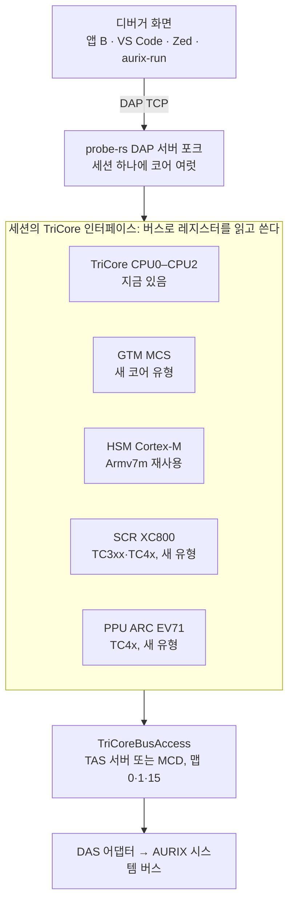

# AURIX 보조 코어 디버깅 검토 (PPU·GTM·SCR·HSM·PCP)

2026-10-25. Claude Docs 원본: [AURIX 보조 코어 디버깅 검토](https://claude.ai/artifact/GHp1rfUJ9oQ8wzft8wsA7d)

## 요약

다섯 코어 가운데 지금 보드(TC275)에서 바로 할 수 있는 것은 GTM의 MCS 하나다. 그것도 실행 제어가 아니라 상태·메모리 보기와 GTM 전체 멈추기 수준이다. 나머지는 이 칩에 없거나(SCR·PPU·PCP), 자료가 공개되지 않았고 칩을 잠글 위험이 있다(HSM).

- **GTM(MCS):** 모든 AURIX에 있다. 이 보드에는 GTM 1.5.5와 MCS 4개(채널 8개씩)가 있다. 레지스터와 메모리는 지금 버스(맵 0)로 읽힌다. GTM 전체 멈추기는 매뉴얼의 `GTM_OCS.SUS = 2`(Soft suspend)로 TriCore와 함께 할 수 있다. BP와 한 단계 실행은 GTM 4.1(TC4x)의 BP 유닛이나 Emulation Device의 MCDS가 필요한데, 이 보드는 ED가 아닌 것으로 보인다(CHIPID.EEA = 0, EMEM 읽기 거부).
- **HSM(Cortex-M):** TC2xx·TC3xx 일부 칩에 있고, 이 보드에도 있지만(CHIPID.SEC = 1) HSM 부팅이 꺼져 있어 돌지 않는다. 매뉴얼에 따르면 HSM 디버그는 디버거의 버스 마스터(Cerberus)가 HSM 권한을 얻는 방식이다. 코어 디버그 접근 방법은 Infineon과 NDA를 맺은 사용자에게만 공개된다. HSM 부팅이나 UCB를 잘못 건드리면 칩이 영구히 잠긴다. 자료와 시험용 칩이 생기기 전에는 하지 않는다.
- **SCR(XC800):** TC3xx 일부와 TC4x에 있고, TC27x에는 없다. 칩의 DAP으로 메모리에 매핑된 OCDS에 닿고, Infineon MCD(`mcdxdas`)도 `XC800` 코어로 내주므로 우리 구조에 가장 잘 맞는 다음 대상이다. TC3xx 보드(WP-6)가 있어야 한다.
- **PPU(ARC EV71):** TC4x에만 있다. 레지스터 자료는 공개되지 않았지만, Infineon TCF 에이전트(vscode-aurix-tcf-debugger)는 PPU·CDSP를 MCD 코어로 멈추고 BP·한 단계를 한다. 우리도 MCD 프로브 경로로 같은 일을 할 수 있을 것으로 본다. TC4x 보드가 먼저다.
- **PCP:** AUDO(TC1766, TC1797 등) 전용이다. AURIX에는 없어(TC27x SVD에도 없음) 범위 밖으로 둔다.

권장: 1단계로 GTM MCS를 "보는" 기능(채널 상태·PC·레지스터, MCS RAM, 디스어셈블리, GTM 전체 멈춤)을 소프트웨어만으로 만든다. 실행 제어와 다른 코어는 관문(ED 보드와 맵 1 어댑터, TC3xx·TC4x 보드, HSM 자료)이 열릴 때 하나씩 더한다. SCR·PPU는 MCD 코어 경로로 작업이 크게 줄 수 있다. 이 보드가 ED가 아니라면 WP-5(MCDS)도 맵 1 어댑터만으로는 검증할 수 없다.

## 대상 코어

| 코어 | 명령어 구조 | 있는 칩 | 이 보드(TC275) |
| --- | --- | --- | --- |
| GTM MCS(Multi Channel Sequencer) | Bosch GTM 전용 명령어. 채널마다 R0–R7·PC | 모든 AURIX: TC2xx(GTM 1.5.x), TC3xx(GTM 3), TC4x(eGTM 4.1) | 있음: GTM 1.5.5, MCS0–MCS3, 채널 8개씩(확인함) |
| HSM(Hardware Security Module) | Arm Cortex-M(Lauterbach "HSM (Cortex-M)", 흔히 M3) | TC2xx·TC3xx의 일부 변형. TC4x는 CSRM(TriCore)으로 바뀜 | 모름: 공개 SVD에 HSM 블록이 없고, TC275T에 HSM이 있는지 확인하지 못함 |
| SCR(Standby Controller) | XC800(8051 호환), 최대 20 MHz, XRAM 8 KB | TC3xx 일부, TC4x | 없음 |
| PPU(Parallel Processing Unit) | Synopsys ARC EV71(벡터 DSP) | TC4x만 | 없음 |
| PCP/PCP2(Peripheral Control Processor) | PCP 전용 명령어 | AUDO(TC1766, TC1797 등)만 | 없음(AURIX는 DMA가 대신함) |

TC4x에는 이 밖에 CSRM(보안용 TriCore)과 cDSP가 있다. CSRM은 TriCore라 지금 코어 구현을 거의 그대로 쓸 수 있을 것으로 보이나, 잠금 조건은 찾지 못했다.

## 코어별 디버그 방법

### GTM MCS

- **디버그 하드웨어:** GTM 4.1 전에는 MCS 자체에 BP·한 단계가 없다. 디버그 인터페이스는 "GTM에 붙은 것, GTM의 일부가 아님"이고, 할 수 있는 것은 GTM 전체 멈추기, 메인 코어와 함께 멈추고 다시 돌리기, MCS 채널·모듈 레지스터 접근이다(PLS, 2017). GTM 4.1은 MCS마다 break-before-make BP 2개(프로그램 주소·범위, 데이터 주소·값, 채널 선택)를 더해 한 단계와 BP가 된다.
- **AURIX의 접근 경로:** MCS 메모리와 레지스터는 메인 코어 주소 공간(FPI)에 매핑돼 있다. TRACE32는 AURIX에서 MCS 온칩 BP를 Emulation Device에서만 쓴다: 최대 4개, 명령 주소만, MCDS 경로(OTGB0 = MCA). 소프트웨어 BP는 없다. MCS 하나가 디버거 창 하나(AMP)이고, 메인 코어가 GTM을 먼저 올리고 시작해야 한다. Lauterbach는 TC275 A-step에서 GTM을 멈추지 말라고 적는다.
- **도구:** TRACE32(TriCore 라이선스에 포함), PLS UDE, HighTec GTM/MCS C 컴파일러(MCS 3.x·4.x).
- **우리가 할 수 있는 것:** 지금 보드에서는 MCS 채널 상태·PC·R0–R7과 MCS RAM 보기, 채널 켜기·끄기, GTM 전체 멈추기(TriCore와 함께), MCS 디스어셈블리. BP는 ED 보드와 맵 1을 여는 어댑터(MCDS) 또는 TC4x(GTM 4.1)가 있어야 한다.
- **TC27x 매뉴얼(25장, GTM V1.9):** GTM은 `gtm_halt` 신호로 SYS_CLK를 꺼서 멈추고, 멈춘 동안 디버거가 모든 GTM 레지스터와 내부 RAM을 읽고 쓸 수 있다("한 단계 모드에서의 레지스터 수정" 포함, 25.2.6). 바깥에서는 `GTM_OCS`(`0xF019FDE8`)의 `SUS`로 고른다: `2` = Soft suspend(GTM Halt Mode, 레지스터 읽고 쓰기 가능), `1` = Hard suspend. OCDS 트리거 스위치(OTGS)의 suspend 신호에 반응하므로, TriCore 멈춤에 GTM을 묶는 것은 지금의 halt group 라우팅과 같은 장치다. 디버그 모드(OCDS 켜짐)에서만 효과가 있고 쓰기는 Supervisor 모드 32비트다. MCS의 채널·주소·PC는 OTGB Trigger Set `TS16_MCA`, 데이터는 `TS32_MCD`로 MCDS에 나간다(`GTM_OTSS`, 25.22.12).

### HSM (Cortex-M)

- **디버그 하드웨어:** Cortex-M의 디버그 장치(정지, 한 단계, FPB BP, DWT 워치포인트)가 있을 것으로 보이나, AURIX DAP에서 그 레지스터에 닿는 경로(AHB-AP인지, 시스템 버스 창인지)는 공개 자료에 없다.
- **자료:** Lauterbach는 HSM 디버그 설명서를 Infineon과 HSM NDA를 맺고 Infineon의 서면 승인을 받은 사용자에게만 주고, TriCore 라이선스에 Cortex-M 라이선스를 더 요구한다. winIDEA는 HSM을 UCB로 켜고 두 번째 디버거 창으로 디버그한다.
- **동작 주의:** 디버거가 붙은 채 리셋하면 부트 코드가 HSM 첫 명령에 BP를 걸어 HSM이 멈춘다(메인 코어가 HSM을 기다리면 동기화가 깨짐). 앱 리셋 뒤에는 HSM이 곧바로 돌아 BP가 사라진다. Lauterbach의 `SYStem.Option.HSMRESTART`·`SSWWAIT`가 이를 다룬다.
- **우리가 할 수 있는 것:** probe-rs의 Armv7m 구현을 재사용하는 설계는 준비할 수 있다. 접근 경로는 NDA 자료 없이는 정할 수 없고, 실칩 시험은 HSM이 켜진 시험용 칩이 필요하다.
- **TC27x 매뉴얼(1.3, 10.5.5.6):** HSM은 "보안용 별도 프로세서 서브시스템, SPB에 마스터·슬레이브로 연결"이고 나머지는 Infineon 문의다(코어·디버그 레지스터 설명 없음). SSW가 `PROCONHSMCOTP.HSMBOOTEN`일 때 HSM을 부팅하고, HSM 펌웨어가 `HSMDBGDIS = 0`이면 HSM 디버그를 켜고 `PROCONHSM.DBGIFLCK = 0`이면 칩 디버그 인터페이스 잠금을 푼다. HSM 디버그가 켜지면 디버거의 버스 마스터 Cerberus가 HSM과 같은 권한으로 HSM 전용 플래시·자원에 닿는다. HSM 펌웨어가 실패하면(예: HSM 코드 없음) SSW가 멈춰 칩이 부팅하지 않는다. OCDS(OSTATE) 문서는 배포 제한이다.
- **이 보드:** HSM은 있지만(SEC = 1) `HSMBOOTEN = 0`이라 돌지 않는다. HSM을 디버그하려면 HSM 코드를 쓰고 UCB_HSMCOTP에서 부팅을 켜야 하는데, 그 자체가 잠금 위험이 있는 UCB 쓰기다.

### SCR (XC800)

- **디버그 하드웨어:** XC800 OCDS. 1.5 KB 모니터 ROM과 64 B 모니터 RAM이 있고, 단일 핀 DAP(SPD)가 있다. XRAM 8 KB는 SPB로 읽힌다.
- **경로 두 가지:** (1) 칩의 DAP: TriCore가 계속 도는 동안만, 저전력 모드에서는 안 됨. `PMS_PMSWCR4`를 쓰고(예 `0x030A0023`) `PMSWSTATCLR`로 켠다. 우리 버스로 할 수 있는 경로다. (2) SCR 전용 DAP/SPD: standby에서도 되지만 두 번째 프로브가 필요하고, SCR이 `PMSWCR4.SCRCFG`로 OCDS 모드에서 시작해야 한다. 두 경로 모두 DAP 10 MHz 이하.
- **알려진 문제:** OCDS 모드에서 모니터가 주소 0에 BP를 걸어, TRAP_EN 없이는 실행이 깨진다(주소 0에 NOP으로 피함, Lauterbach 포럼). SFR 주소가 step A와 B에서 다르다.
- **도구:** TRACE32(i51 디버거), winIDEA, UDE.
- **우리가 할 수 있는 것:** 8051 코어 유형(레지스터, OCDS 모니터 명령, 디스어셈블러)을 새로 만든다. 칩 DAP 경로는 지금 TAS 버스로 닿는다. TC3xx 보드가 있어야 시험할 수 있다.

### PPU (ARC EV71)

- **도구:** TRACE32("PPU (ARC)"), UDE(TriCore와 PPU를 한 창에서), Synopsys MetaWare(컴파일러·디버거·nSIM), HighTec PPU 도구.
- **경로:** Lauterbach가 말하는 MCD 인터페이스는 Synopsys VDK(가상 칩) 얘기다. 실칩에서 PPU 디버그 레지스터에 닿는 방법과 잠금 조건은 공개되지 않았다(TC4x 자료는 myInfineon 비공개).
- **우리가 할 수 있는 것:** TC4x 보드와 자료 없이는 없다. ARC 코어 구현은 probe-rs에도 없어 처음부터 만들어야 한다.

### PCP (AUDO)

- **디버그:** FPI 버스로 OCDS-L1을 거치고 TriCore 디버거가 먼저 올라 있어야 한다. BP는 소프트웨어 BP만, 채널은 CPU 트리거로만 시작한다(TRACE32 PCP 설명서).
- **우리가 할 수 있는 것:** 우리 디버거는 AURIX만 대상이라 범위 밖이다. AUDO 프로젝트가 생기면 다시 본다.

## 다른 도구: vscode-aurix-tcf-debugger

[ZeZhan/vscode-aurix-tcf-debugger](https://github.com/ZeZhan/vscode-aurix-tcf-debugger)(커밋 `fb83b4e`, MIT, 개인 프로젝트)는 TC4x의 PPU·CDSP를 디버그하고, GTM·HSM은 다루지 않는다. 확장은 VS Code 화면만 맡고, 실제 디버깅은 AURIX Configuration Studio에서 가져온 Infineon TCF 에이전트(`bin/aurix-debugger.exe`)가 DAS 8.3의 `mcdxdas.dll`로 한다.

| 코어 | 확장 코드 | 에이전트·DAS 바이너리의 문자열 | 판단 |
| --- | --- | --- | --- |
| PPU | ELF 하나, 코어 선택 마스크(`-A`), 코어별 메모리 맵 | `Core %d: CPU%d PPU`, `getState PPU … Halted`, `Breakpoint set on PPU`, `context_read_reg PPU`, `mcd.read PPU`, LLVM 디스어셈블러 | 지원: MCD 코어로 정지·실행·BP·레지스터 |
| CDSP(TC4x, 12개) | ELF 12개(CDSP0–CDSP11) | `Core %d: CPU%d CDSP%d`, `CDSP Single Step`, `Calling Stepover for CDSP` | 지원: 같은 방식 |
| SCR | "SCR (Standby Controller) (reserved)" 설정칸만 | 에이전트에 SCR 디스어셈블리, DAS에 `Core %d: XC800` | 준비 중. DAS는 SCR을 MCD 코어로 안다 |
| GTM·HSM·CSRM | 없음 | 없음 | 지원하지 않음 |

우리에게의 뜻: 우리 MCD 프로브는 지금 `mcdxdas`의 메모리 접근(`mcd_execute_txlist`)과 리셋만 쓴다. Infineon MCD가 보조 코어를 코어로 내주는 칩(TC4x의 PPU·CDSP, SCR이 있는 칩)에서는, MCD의 실행 제어·레지스터 함수를 쓰는 "MCD 코어" 유형 하나로 PPU·CDSP·SCR을 함께 다룰 수 있다. 레지스터 자료 없이도 된다는 점에서, 코어마다 디버그 장치를 직접 구현하는 것보다 빠르다. 대신 TAS 경로가 아니라 MCD 경로(Windows, DAS 설치)에 묶인다. 이 TC275에서 `mcdxdas`(1.14.12)가 내주는 코어는 TriCore 3개뿐이다.

## 우리 구조에 붙이는 방법

보조 코어는 새 프로브가 아니라, 지금 TriCore가 쓰는 버스(TAS·MCD) 위에 새 코어 유형으로 붙인다. TriCore 디버그가 이미 메모리에 매핑된 레지스터만으로 돌고, probe-rs에는 같은 모양의 선례가 있다: RP2350은 ARM 디버그 포트 뒤의 RISC-V 코어를 메모리 창으로 붙인다(`ArchitectureInterface::ArmWithRiscv`).

- **세션:** probe-rs는 아직 한 세션에 서로 다른 아키텍처를 섞지 못한다(`session.rs`의 "we still don't support mixed architectures"). 보조 코어를 넣으려면 `ArchitectureInterface::TriCore`가 코어마다 다른 코어 구현을 돌려주게 해야 한다. 타깃 YAML에 보조 코어를 코어로 적고, `CoreType`을 더한다.
- **재사용:** HSM은 probe-rs의 Cortex-M(Armv7m) 구현을 그대로 쓸 수 있다. 필요한 것은 Cortex-M 디버그 레지스터(`DHCSR` 등)에 닿는 ARM 메모리 인터페이스를 TriCore 버스 위에 만드는 것뿐이다. GTM·SCR·PPU는 probe-rs에 없는 명령어 구조라 코어 구현, 디스어셈블러, 콜스택(DWARF 레지스터 번호)을 새로 만든다.
- **화면:** DAP 서버와 앱 B는 코어를 스레드로 보여 주므로, 코어 구현이 있으면 스레드·콜스택·BP·메모리 보기는 거의 그대로 된다. 다른 것은 코어마다 ELF가 따로인 것(GTM MCS 코드, HSM 펌웨어)과 디스어셈블리다.
- **MCD 코어 경로:** Infineon MCD가 보조 코어를 코어로 내주는 칩(TC4x의 PPU·CDSP, SCR)에서는 그림의 "버스 위 새 코어 유형" 대신, MCD의 실행 제어·레지스터 함수를 부르는 코어 유형 하나로 될 수 있다. Infineon TCF 에이전트가 이 방식이다(위 "다른 도구"). 코어별 디스어셈블러와 DWARF 레지스터 번호는 여전히 필요하다.

## 보드에서 확인한 것

이 TC275(ShieldBuddy, JTAG ID `0x401DA083`, SCU_CHIPID `0x47427060`)에서 보조 코어 가운데 보이는 것은 GTM뿐이고, 그것도 디버그 코어가 아니라 레지스터로만 보인다. 모두 읽기만 했고, 코어는 멈추지 않았다(2026-10-25).

| 확인 | 결과 | 뜻 |
| --- | --- | --- |
| Infineon MCD(`mcdxdas.dll`)의 코어 목록 | `CPU0 TriCore 1.6E`, `CPU1`·`CPU2 TriCore 1.6P` 세 개뿐 | DAS가 HSM·GTM을 디버그 코어로 내주지 않는다. 보조 코어의 실행 제어는 우리가 레지스터로 직접 만들어야 한다 |
| GTM 버전 `GTM_REV`(`0xF0100000`) | `0x103155A1`: GTM 1.5.5, step A1 | MCS가 있는 GTM. 버전마다 MCS 디버그 기능이 다르다 |
| GTM 클럭 `GTM_CLC`(`0xF019FD00`) | `0x00000000`(켜짐) | GTM 레지스터를 읽을 수 있다 |
| MCS0 채널 0 레지스터(`0xF0130000`) | 읽힘(`0`) | 맵 0으로 MCS 상태가 보인다. 지금 서버의 메모리·주변장치 보기로도 읽힌다 |
| SVD(`TC27XDPD`)의 블록 | GTM(MCS0–MCS3, 채널 8개씩), DMA, SCU. SCR·PCP·PPU·HSM 블록 없음 | TC27x에는 SCR·PCP·PPU가 없다. HSM 레지스터는 공개 SVD에 없다 |
| 주소 맵 1(EEC) | `0x8D`로 거부(기존 확인) | 칩에 EEC가 없다면(아래 EEA = 0) 어댑터와 상관없이 거부된다. 어느 쪽 탓인지는 ED 보드에서만 가린다 |
| SCU_CHIPID `0x47427060`(매뉴얼 7.4.8.2로 해석) | SEC = 1(HSM 있음), EEA = 0(EEC 없음), CHREV `0x20`(C-step), FSIZE 4 MB | HSM이 있는 칩이다. Emulation Device가 아닌 것으로 보인다(기존 문서는 ED로 적었음) |
| EMEM `0x9F000000`·`0xBF000000`, DF0 `0xAF000000` | EMEM 둘 다 `0x8D`로 거부, DF0는 읽힘 | 예전에 "EMEM이 읽힌다"고 본 `0xAF00xxxx`는 DF0(데이터 플래시)였다. MCDS가 없으면 GTM BP·트레이스(WP-5)는 이 보드로 검증할 수 없다 |
| FLASH0 `PROCONHSMCOTP`(`0xF8002034`), `PROCONDBG`(`0xF8002058`), `PROCONHSM`(`0xF800205C`) | 모두 `0x00000000` | `HSMBOOTEN = 0`: HSM은 부팅되지 않는다. HSM 디버그·디버그 인터페이스·OCDS를 막는 설정은 없다 |

## 제약

| 제약 | 걸리는 코어 | 내용 | 대응 |
| --- | --- | --- | --- |
| 칩 영구 잠금 | HSM | HSM 코드 없이 HSM 부팅(HSMBOOTEN)을 켜거나, HSM이 켜진 채 HSM 플래시 섹터를 지우거나, UCB_HSMCOTP의 PROCONHSMCBS가 틀리면 영구히 잠긴다. UCB_DBG의 PROCONDBG.OCDSDIS만 켜도 정지가 막힌다 | 우리 도구는 UCB를 쓰지 않는다(지금 규칙 그대로). HSM은 버려도 되는 시험용 칩에서만 |
| 비공개 자료 | HSM, PPU, CSRM | HSM 디버그 설명은 Infineon NDA와 서면 승인 뒤에만. TC4x 자료는 myInfineon 비공개 | 프로젝트가 Infineon에 요청한다(사용자 결정) |
| ED 보드·어댑터 | GTM BP(TC2xx·TC3xx) | 온칩 BP가 ED의 MCDS(맵 1)를 거친다. 이 보드는 ED가 아닌 것으로 보이고(EEA = 0), DAS 어댑터도 맵 1을 막는다 | ED 보드와 맵 1 어댑터. WP-5(MCDS)와 같은 조건 |
| 칩·보드 | SCR(TC3xx·TC4x), PPU·GTM 4.1(TC4x) | 이 보드(TC275)에는 없다 | WP-6의 TC3xx 보드, TC4x 보드 |
| 디버그 잠금 | 모든 코어 | OCDS는 기본으로 꺼져 있고, DAP·JTAG은 256비트 암호로 잠길 수 있다(검색 요약으로만 확인) | 양산 ECU는 잠긴 상태일 수 있음을 전제로 한다 |
| 클럭 | SCR | DAP 10 MHz 이하 | 지금 기본 6 MHz는 조건을 만족한다 |
| 동작 보장 | GTM | Lauterbach: TC275 A-step에서 GTM을 멈추지 말 것 | 이 칩의 step을 먼저 확인한다 |

라이선스 비교: TRACE32는 GTM·PCP 디버그를 TriCore 라이선스에 포함하고, HSM은 Cortex-M 라이선스를 더 요구한다. 우리 도구에는 라이선스 비용이 없고, 비용은 자료·보드·어댑터다.

## 권장 작업 순서와 규모

지금 할 수 있는 것은 1단계(GTM MCS 보기)뿐이고, 나머지는 관문이 열리는 대로 하나씩 더한다. 관문은 서로 독립이라 순서는 열리는 차례다. 규모는 어림이다.

| 단계 | 관문 | 일 | 규모 |
| --- | --- | --- | --- |
| 1. GTM MCS 보기 | 없음(지금 TC275로) | MCS 채널 상태·PC·R0–R7, MCS RAM, 디스어셈블리. 채널 켜기·끄기, GTM 전체 멈추기, 앱 B의 GTM 탭 | 중간 |
| 2. GTM MCS BP·한 단계 | ED 보드 + 맵 1 어댑터, 또는 TC4x 보드 | ED: MCDS 경로의 온칩 BP(최대 4개), 이 보드는 ED가 아님. TC4x: GTM 4.1의 MCS마다 BP 2개, 한 단계 | 중간 |
| 3. SCR (XC800) | TC3xx 보드(WP-6) | 8051 코어 유형, OCDS 모니터 명령, 디스어셈블러. 칩 DAP 경로(PMSWCR4) 또는 MCD의 XC800 코어 | 큼 |
| 4. HSM (Cortex-M) | Infineon NDA 자료, HSM이 켜진 시험용 칩 | probe-rs Armv7m 재사용, 버스 위 ARM 메모리 인터페이스. UCB·HSM 플래시는 쓰지 않음 | 중간 |
| 5. PPU (ARC EV71) | TC4x 보드, PPU를 코어로 내주는 DAS | MCD 코어 경로(Infineon TCF 에이전트 방식), CDSP도 같이. TC4x의 CSRM(TriCore)은 지금 코어 구현에 가깝다 | 큼 |

1단계의 수용 기준 안: 플래시 데모나 RAM 시험 펌웨어에 MCS 코드를 하나 넣고, 앱 B의 GTM 탭이 채널마다 켜짐·PC·R0–R7을 0.5초마다 보여 주고, 메모리 탭으로 읽은 값과 같아야 한다. GTM 멈추기는 TC27x 설명서의 멈춤 비트를 확인한 뒤에만 넣는다.

## 미결 사항

- [x] TC275T(이 보드)에 HSM이 있는가. → 있다: CHIPID.SEC = 1(매뉴얼 7.4.8.2). 다만 HSMBOOTEN = 0이라 돌지 않는다.
- [ ] HSM Cortex-M 디버그 레지스터에 AURIX DAP에서 닿는 경로(AHB-AP인지, 시스템 버스 창인지). 매뉴얼은 Cerberus가 HSM 권한을 얻는다는 데까지만 설명한다. HSM 자료는 사용자가 내일 더해 주기로 함.
- [x] GTM 1.5.5의 디버그 인터페이스가 GTM을 멈추는 레지스터. → GTM_OCS(0xF019FDE8)의 SUS = 2(Soft suspend), OTGS suspend 신호에 반응(매뉴얼 25.2.6, OCS).
- [x] 이 칩의 step(A/B/C)과, A-step의 GTM 정지 주의가 해당하는지. → C-step(CHREV 0x20)이라 해당하지 않는다. 받은 매뉴얼은 D-step판(V2.2)이라 차이는 delta 문서로 확인한다.
- [ ] 이 보드가 정말 ED가 아닌지(보드 부품 번호, CHID 0x70의 데이터시트 부록). ED가 아니면 WP-5와 GTM MCS BP에는 ED 보드(예: TriBoard TC275 ED)가 따로 필요하다.
- [ ] SCR·PPU·CSRM을 쓸 프로젝트와 칩(WP-6과 함께 정한다).

## 출처

- Lauterbach: [TriCore 디버거 설명서](https://www2.lauterbach.com/pdf/debugger_tricore.pdf)(HSM NDA·라이선스, HSM 부팅 잠금 경고), [GTM 디버거 설명서](https://www2.lauterbach.com/pdf/debugger_gtm.pdf)(ED의 온칩 BP 4개, AMP, TC275 A-step), [PCP 디버거 설명서](https://www2.lauterbach.com/pdf/debugger_pcp.pdf), [TriCore 플라이어 v2.00](https://www2.lauterbach.com/download/pdf/flyer/lauterbach-tricore-flyer-v2.00.pdf)(칩별 보조 코어), [TC4x 지원 발표](https://www.lauterbach.com/news_582.html), [Synopsys VDK 지원 발표](https://www.lauterbach.com/news_568.html), [SCR 디버그 방법](https://support.lauterbach.com/kb/articles/tricore-standby-controller-debug-methods), [TC3xx SCR 연결 포럼](https://support.lauterbach.com/community/view/use-lauterbach-to-connect-tc3xx-scr), [SSWWAIT와 시작 동작](https://support.lauterbach.com/kb/articles/sswwait-and-startup-behavior-with-debugger-attached)
- Bosch IP Tech Day: [Lauterbach TRACE32 for Bosch GTM (2024)](https://bosch-semiconductors.com/media/events/2024/ip_techday_asia_2024/presentations/b06-lauterbach_trace32_for_bosch_gtm.pdf)(GTM 4.1의 BP 유닛), [PLS GTM 디버깅 (2017)](https://www.bosch-semiconductors.com/media/events/techday_presentations/09_pls.pdf)
- PLS: [TC3xx 디버깅](https://pls-mc.com/products/tricore-aurix-tc3xx-debugging-and-trace/), [TC4x](https://pls-mc.com/products/infineon-aurix-tc4-tc4x-microcontrollers), [GTM 지원](https://pls-mc.com/products/generic-timer-module-gtm-support), [UDE의 TC4x 지원](https://pls-mc.com/news/new-aurix-tc4x-family-supported-by-ude/)
- TASKING winIDEA: [HSM 디버깅](https://www.tasking.com/documentation/winidea/hsm-debugging.html), [TC3xx HSM 프로그래밍](https://www.tasking.com/documentation/winidea/tc3-hsm-programming.html), [SCR 디버깅](https://www.tasking.com/documentation/winidea/scr-debugging.html), [HSM BP와 리셋](https://kb.tasking.com/KB/123/Article/441)
- Infineon: [TC3xx SCR 개요](https://documentation.infineon.com/aurixtc3xx/docs/luk1713080514892), [TC4x SCR](https://documentation.infineon.com/aurixtc4xx/docs/qnw1545140364277), [TC3xx 잠금 주의 사항](https://www.infineon.com/assets/row/public/documents/10/57/infineon-aurix-tc3xx-devicelocking-dos-and-donts-additionaltechnicalinformation-en.pdf)
- HighTec: [개발 플랫폼](https://hightec-rt.com/products/development-platform)(GTM/MCS, PPU, Cortex-M 컴파일러)
- Infineon AURIX TC27x D-Step User's Manual V2.2(2014-12, 사용자가 `docs/`에 둔 사본, 저장소에는 넣지 않음): 1.3 HSM, 1.4 OCDS, 7.4.8.2 CHIPID, 10.5.5.6 Flash 보호와 HSM 부팅, PROCONHSMCOTP·PROCONHSM, 25.2.6 GTM Software Debugger Support, GTM OCS·CLC, 25.22.12 GTM Debug Interface(OTGB, OTSS), 메모리 맵(DF0 `0xAF000000`, EMEM `0x9F000000`)
- [ZeZhan/vscode-aurix-tcf-debugger](https://github.com/ZeZhan/vscode-aurix-tcf-debugger) `fb83b4e`: `src/debugProvider.ts`·`debugConfigPanel.ts`(PPU·CDSP·SCR), `bin/aurix-debugger.exe`·`bin/mcdxdas.dll`의 문자열
- 이 보드: `mcd_list`(Infineon `mcdxdas.dll`), `probe-rs read`로 GTM_REV·GTM_CLC·MCS0, probe-rs 포크의 `TC27XDPD` SVD, probe-rs `session.rs`(섞인 아키텍처 미지원, `ArmWithRiscv`)
