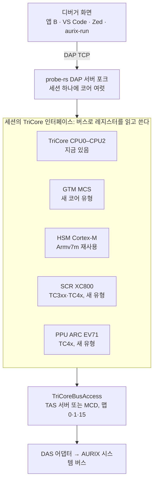

# AURIX 보조 코어 디버깅 검토 (PPU·GTM·SCR·HSM·PCP)

2026-10-25. Claude Docs 원본: [AURIX 보조 코어 디버깅 검토](https://claude.ai/artifact/GHp1rfUJ9oQ8wzft8wsA7d)

## 요약

다섯 코어 가운데 지금 보드(TC275)에서 바로 할 수 있는 것은 GTM의 MCS 하나다. 그것도 실행 제어가 아니라 상태·메모리 보기와 GTM 전체 멈추기 수준이다. 나머지는 이 칩에 없거나(SCR·PPU·PCP), 자료가 공개되지 않았고 칩을 잠글 위험이 있다(HSM).

- **GTM(MCS):** 모든 AURIX에 있다. 이 보드에는 GTM 1.5.5와 MCS 4개(채널 8개씩)가 있다. 레지스터와 메모리는 지금 버스(맵 0)로 읽힌다. GTM 전체 멈추기는 매뉴얼의 `GTM_OCS.SUS = 2`(Soft suspend)로 TriCore와 함께 할 수 있다. BP와 한 단계 실행은 GTM 4.1(TC4x)의 BP 유닛이나 Emulation Device의 MCDS가 필요한데, 이 보드는 ED가 아닌 것으로 보인다(CHIPID.EEA = 0, EMEM 읽기 거부).
- **HSM(Cortex-M):** TC2xx·TC3xx 일부 칩에 있고, 이 보드에도 있지만(CHIPID.SEC = 1) HSM 부팅이 꺼져 있어 돌지 않는다. HSM 디버그는 디버거의 버스 마스터(Cerberus)가 시스템 버스의 64 KB 창(`DBGBASE`·`DBGMEM`)으로 HSM의 Cortex-M 디버그 레지스터에 닿는 방식이다(TC3xx 자료와 TC36x 보드로 확인, 창 주소 `0xF0050000`은 TC3xx 예제 헤더로 확인). TC27x의 HSM 블록과 레지스터 주소는 TC3xx와 같다(TC27x 매뉴얼 주소 맵과 TC27x 예제 헤더). 다만 이 보드(TC275)에서는 HSM 부팅이 꺼져 있어 블록 전체가 버스 오류다. HSM 부팅이나 UCB를 잘못 건드리면 칩이 영구히 잠긴다. 자료와 시험용 칩이 생기기 전에는 하지 않는다.
- **SCR(XC800):** TC3xx 일부와 TC4x에 있고, TC27x에는 없다. 칩의 DAP으로 메모리에 매핑된 OCDS에 닿고, Infineon MCD(`mcdxdas`)도 `XC800` 코어로 내주므로 우리 구조에 가장 잘 맞는 다음 대상이다. TC3xx 보드(WP-6)가 있어야 한다.
- **PPU(ARC EV71):** TC4x에만 있다. 레지스터 자료는 공개되지 않았지만, Infineon TCF 에이전트(vscode-aurix-tcf-debugger)는 PPU·CDSP를 MCD 코어로 멈추고 BP·한 단계를 한다. 우리도 MCD 프로브 경로로 같은 일을 할 수 있을 것으로 본다. TC4x 보드가 먼저다.
- **PCP:** AUDO(TC1766, TC1797 등) 전용이다. AURIX에는 없어(TC27x SVD에도 없음) 범위 밖으로 둔다.

권장: 1단계로 GTM MCS를 "보는" 기능(채널 상태·PC·레지스터, MCS RAM, 디스어셈블리, GTM 전체 멈춤)을 소프트웨어만으로 만든다. 실행 제어와 다른 코어는 관문(ED 보드와 맵 1 어댑터, TC3xx·TC4x 보드, HSM 자료)이 열릴 때 하나씩 더한다. SCR·PPU는 MCD 코어 경로로 작업이 크게 줄 수 있다. 이 보드가 ED가 아니라면 WP-5(MCDS)도 맵 1 어댑터만으로는 검증할 수 없다.

## 대상 코어

| 코어 | 명령어 구조 | 있는 칩 | 이 보드(TC275) |
| --- | --- | --- | --- |
| GTM MCS(Multi Channel Sequencer) | Bosch GTM 전용 명령어. 채널마다 R0–R7·PC | 모든 AURIX: TC2xx(GTM 1.5.x), TC3xx(GTM 3), TC4x(eGTM 4.1) | 있음: GTM 1.5.5, MCS0–MCS3, 채널 8개씩(확인함) |
| HSM(Hardware Security Module) | Arm Cortex-M(Lauterbach "HSM (Cortex-M)", 흔히 M3) | TC2xx·TC3xx의 일부 변형. TC4x는 CSRM(TriCore)으로 바뀜 | 있음: CHIPID.SEC = 1, 다만 HSM 부팅 꺼짐(`HSMBOOTEN = 0`). 공개 SVD에 HSM 블록이 없다. 매뉴얼 주소 맵의 블록(`0xF0040000`-, TC3xx와 같음)은 이 보드에서 버스 오류 |
| SCR(Standby Controller) | XC800(8051 호환), 최대 20 MHz, XRAM 8 KB | TC3xx 일부, TC4x | 없음 |
| PPU(Parallel Processing Unit) | Synopsys ARC EV71(벡터 DSP) | TC4x만 | 없음 |
| PCP/PCP2(Peripheral Control Processor) | PCP 전용 명령어 | AUDO(TC1766, TC1797 등)만 | 없음(AURIX는 DMA가 대신함) |

TC4x에는 이 밖에 CSRM(보안용 TriCore)과 cDSP가 있다. CSRM은 TriCore라 지금 코어 구현을 거의 그대로 쓸 수 있을 것으로 보이나, 잠금 조건은 찾지 못했다.

## 코어별 디버그 방법

### GTM MCS

- **디버그 하드웨어:** GTM 4.1 전에는 MCS 자체에 BP·한 단계가 없다. 디버그 인터페이스는 "GTM에 붙은 것, GTM의 일부가 아님"이고, 할 수 있는 것은 GTM 전체 멈추기, 메인 코어와 함께 멈추고 다시 돌리기, MCS 채널·모듈 레지스터 접근이다(PLS, 2017). GTM 4.1은 MCS마다 break-before-make BP 2개(프로그램 주소·범위, 데이터 주소·값, 채널 선택)를 더해 한 단계와 BP가 된다.
- **AURIX의 접근 경로:** MCS 메모리와 레지스터는 메인 코어 주소 공간(FPI)에 매핑돼 있다. TRACE32는 AURIX에서 MCS 온칩 BP를 Emulation Device에서만 쓴다: 최대 4개, 명령 주소만, MCDS 경로(OTGB0 = MCA). 소프트웨어 BP는 없다. MCS 하나가 디버거 창 하나(AMP)이고, 메인 코어가 GTM을 먼저 올리고 시작해야 한다. Lauterbach는 TC275 A-step에서 GTM을 멈추지 말라고 적는다.
- **도구:** TRACE32(TriCore 라이선스에 포함), PLS UDE, HighTec GTM/MCS C 컴파일러(MCS 3.x·4.x).
- **우리가 할 수 있는 것:** 지금 보드에서는 MCS 채널 상태·PC·R0–R7과 MCS RAM 보기, 채널 켜기·끄기, GTM 전체 멈추기(TriCore와 함께), MCS 디스어셈블리. BP는 ED 보드와 맵 1을 여는 어댑터(MCDS) 또는 TC4x(GTM 4.1)가 있어야 한다.
- **TC27x 매뉴얼(25장, GTM V1.9):** GTM은 `gtm_halt` 신호로 SYS_CLK를 꺼서 멈추고, 멈춘 동안 디버거가 모든 GTM 레지스터와 내부 RAM을 읽고 쓸 수 있다("한 단계 모드에서의 레지스터 수정" 포함, 25.2.6). 바깥에서는 `GTM_OCS`(`0xF019FDE8`)의 `SUS`로 고른다: `2` = Soft suspend(GTM Halt Mode, 레지스터 읽고 쓰기 가능), `1` = Hard suspend. OCDS 트리거 스위치(OTGS)의 suspend 신호에 반응하므로, TriCore 멈춤에 GTM을 묶는 것은 지금의 halt group 라우팅과 같은 장치다. 디버그 모드(OCDS 켜짐)에서만 효과가 있고 쓰기는 Supervisor 모드 32비트다. MCS의 채널·주소·PC는 OTGB Trigger Set `TS16_MCA`, 데이터는 `TS32_MCD`로 MCDS에 나간다(`GTM_OTSS`, 25.22.12).

### HSM (Cortex-M)

- **디버그 하드웨어:** HSM 코어는 Cortex-M3이고, 자기 주소 공간에 표준 디버그 장치가 있다. Infineon HSM 예제의 `debugextension_hsm.h`에 FPB(`0xE0002000`, `FP_COMPH0`-`7`)와 `DHCSR`(`0xE0002000` + 13180 × 4 = `0xE000EDF0`, 표준 위치)가 정의돼 있다.
    - **FPB의 Infineon 확장 `FP_COMPH0`-`7`(BP에 꼭 필요):** 표준 `FP_COMP0`-`7`(`0xE0002008`-`0xE0002024`) 바로 뒤 `0xE0002028`-`0xE0002044`에 있다("Flash Patch Comparator High"). 쓸 수 있는 비트는 bit 2:0의 세 개다(`debugextension_hsm_internal.h`의 `wr_msk 0x7`, AP32349 예제).
        - Cortex-M3 FPB rev 1의 `FP_COMPn.COMP`는 주소 bit 28:2만 담아, 코드 영역(`0x00000000`-`0x1FFFFFFF`)에만 BP를 건다. probe-rs도 `0x20000000` 이상은 거부한다(`armv7m.rs`의 `FpRev1CompX::breakpoint_configuration`).
        - HSM 코드는 PFLASH `0x80000000`부터 링크되고(HSM 쪽 주소, AP32373 `Lcf_Gnuc_Arm_Hsm.lsl`, AP32391 `hsm20.ld`의 `0x80018000`), RAM은 `0x20000000`이다. 그래서 `FP_COMPHn`이 빠진 주소 bit 31:29를 채우는 것으로 본다. 예를 들어 `0x80004000`의 BP는 `FP_COMPHn = 0b100`, `FP_COMPn.COMP = 0x1000`이다. bit 31:29라는 것은 헤더에 적혀 있지 않은 **추론**이다(bit 2:0 세 개가 `COMP`에 빠진 세 비트와 맞음).
        - probe-rs의 Armv7m BP 코드를 그대로 쓰면 HSM 플래시에 BP를 걸 수 없다. HSM용 FPB 설정에서 `FP_COMPHn`도 쓰고 지워야 한다.
        - 이 블록의 `PID0`-`PID3`은 `0x01`·`0x10`·`0x1C`·`0x01`(리셋 값)이다. JEP106 코드 `0x41`(Infineon), 부품 번호 `0x001`이라, ARM의 FPB가 아니라 Infineon이 만든 블록으로 보인다. ROM 테이블로 FPB를 찾는 코드는 이 값을 알아야 한다.
- **접근 경로(TC3xx 자료로 확인):** ARM의 AHB-AP가 아니라 **시스템 버스(SPB)의 창**이다. AURIX에는 ARM 디버그 포트가 없고, 디버거의 버스 마스터 Cerberus가 SPB의 HSM 블록(`0xF0040000`-`0xF005FFFF`, 128 KB)에 닿는다.
    - **블록 안:** TC36x 주소 맵(부록)이 이 블록을 System·Debug·Communication·Reset 레지스터로 나눈다. Debug와 Reset 부분은 호스트에게 "BE"(버스 오류)다.
    - **호스트 쪽 디버그 레지스터:** HSM 예제의 TriCore 쪽 `registers_hsm.h`에 있다. `HSMCTRL` `0xF0041000`, `DBGBASE` `0xF0041010`("Debug Window Base Address", BASE = bit 31:16), `HSMOTGB` `0xF0041020`("OCDS Suspend and Trigger Bus Control", TGS/TGB/TG_P)이다. AP32391 TriCore 예제의 `hsm_Interface.h`는 이 셋을 "Bridge Registers (Host side access only)"라고 적는다. HSM 쪽 브리지 구조체에는 없다.
    - **창:** `DBGBASE`가 HSM 주소의 위 16비트를 고르는 64 KB 창(`DBGMEM`, HSM 쪽 `bridge.h`의 "Debug Memory Window", `DBGCTRL.HSM` = "HSM subsystem and debug memory window")이다. 예제는 `DBGBASE = 0xE0000000`("Halt after Reset" 뒤)과 `0x20000000`("SRAM을 본다")을 쓴다. AP32481은 호스트가 `DBGMEM`으로 HSM RAM을 읽을 수 있다고 적는다.
    - **창의 호스트 주소:** 블록의 위쪽 절반 `0xF0050000`-`0xF005FFFF`다. AP32391 TriCore 예제 `HSM_TC39xB_demo/.../crypto/hsm_Interface.h`가 호스트 쪽 브리지 레지스터 바로 아래에 "DBGMEM, debug memory window 0xF0050000--0xF005FFFFh"라고 적는다(2026-10-27 확인, 이전에는 추정).
        - HSM 쪽에서는 같은 자리가 `SAHMEM`(호스트 메모리를 보는 창, `SAHBASE`가 위 16비트를 고름)이다. 두 창은 방향만 반대이고 같은 배치다.
    - **창의 접근 폭:** 32비트다. HSM 쪽 `bridge.h`(AP32391)의 `HSM_DBGMEM_Type`이 32비트 `DATA` 하나("Data for debug access")다. 8·16비트 접근이 되는지는 적혀 있지 않으니, 우리 쪽은 32비트로 읽고 쓰고 나머지는 읽고-고치고-쓰기로 한다.
    - **열리는 조건:** 창과 디버그 레지스터는 HSM 디버그가 켜졌을 때만 열린다. HSM 펌웨어가 `PROCONHSM.HSMDBGDIS = 0`을 보고 켜며, 그 뒤 Cerberus는 HSM과 같은 권한을 얻는다(UM 6.5.4.4.1, 6.5.4.1).
    - **`DBGCTRL`(HSM 쪽 `0xF0040060`, 호스트 쪽 헤더에는 없음):** HSM이 디버그를 여는 레지스터다(AP32373·AP32391 `bridge_hsm.h`/`bridge.h`, AP32349 `bridge_hsm_internal.h`의 `wr_msk 0x733`).
        - `HSM`(bit 1:0): "Debug control for HSM subsystem and debug memory window". `11`(`HSMDEN`)이면 HSM 디버그와 위의 창이 열리고, `00`-`10`이면 닫힌다.
        - `HOST`(bit 5:4): "Debug control for host system". 칩(TriCore) 디버그 인터페이스에 걸린 HSM 자신의 잠금이다. `11`(`HTDEN`)이면 푼다.
        - `TREN`(bit 9:8), `TRDATA`(bit 10): SPB에서 HSM 접근을 호스트 쪽 트레이스로 보이게 하고(`11`), 주소(0)나 데이터(1)를 고른다.
        - 2비트 필드는 `11`만 켜짐이다(한 비트가 뒤집혀도 열리지 않는 안전한 인코딩).
    - **HSM이 디버그를 여는 순서(AP32562 예제 `Hsm_unlockDebugInterface`, AP32399를 따름):** 챌린지-응답으로 호스트를 인증한 뒤에 연다.
        1. `DBGCTRL.HOST = 11`로 자기 잠금을 푼다.
        2. `CBS_OSTATE.IF_LCK`(`0xF0000480` bit 16)가 켜져 있으면 `CBS_OEC`(`0xF0000478`)에 `0xA1`·`0x5E`·`0xA1`·`0x5E`를 쓰고 `0x00010000`을 써서 푼다.
        3. `DBGCTRL.HSM = 11`로 HSM 디버그를 연다.
        - 그러니 디버거가 할 일은 HSM 펌웨어에 따라 다르다. 펌웨어가 열어 주지 않으면 `DBGBASE`와 창은 계속 버스 오류다.
- **TC36x 보드에서 확인(읽기만, 2026-10-27):** CHIPID.SEC = 1, `PROCONHSMCFG`-`COTP1` = 0(HSM 부팅 꺼짐).
    - `HSM_ID`(`0xF0040008`) = `0x00BEC002`, `HSMCTRL` = 0, `HT2HSMS`/`HSM2HTS` = 0으로 읽힌다.
    - `DBGBASE`, `HSMOTGB`, `0xF0050000`은 버스 오류(`0x8d`)다. HSM 펌웨어가 돌지 않아 HSM 디버그가 열리지 않은 상태이고, 주소 맵의 "BE"와 맞는다.
- **TC275 보드에서 확인(읽기만, 2026-10-27):** 같은 다섯 주소가 모두 버스 오류(`0x8d`)다. `HSM_ID`(`0xF0040008`)와 `HSMCTRL`(`0xF0041000`)도 마찬가지다. 같은 연결에서 `SCU_CHIPID`는 `0x47427060`(SEC = 1)으로 읽힌다.
    - TC36x에서는 `HSM_ID`와 `HSMCTRL`이 읽혔다. TC27x 매뉴얼의 주소 맵과 TC27x 예제 헤더는 블록을 같은 주소에 둔다. 그러니 다른 주소에 있는 것이 아니라, HSM 부팅이 꺼진 TC27x에서는 블록 전체가 닫히는 것으로 보인다(자료에 적힌 곳은 없음, 아래 "TC27x에 필요한 것" 2번).
    - 위의 접근 경로와 아래의 창 변환은 **TC3xx에서 확인된 것**이다. TC27x는 레지스터 주소와 브리지 구조가 같다는 데까지 확인했다.
- **자료:** Lauterbach는 HSM 디버그 설명서를 Infineon과 HSM NDA를 맺고 Infineon의 서면 승인을 받은 사용자에게만 주고, TriCore 라이선스에 Cortex-M 라이선스를 더 요구한다. winIDEA는 HSM을 UCB로 켜고 두 번째 디버거 창으로 디버그한다.
- **동작 주의:** 디버거가 붙은 채 리셋하면 부트 코드가 HSM 첫 명령에 BP를 걸어 HSM이 멈춘다(메인 코어가 HSM을 기다리면 동기화가 깨짐). 앱 리셋 뒤에는 HSM이 곧바로 돌아 BP가 사라진다. Lauterbach의 `SYStem.Option.HSMRESTART`·`SSWWAIT`가 이를 다룬다.
- **우리가 할 수 있는 것(TC3xx):** probe-rs의 Armv7m 구현을 그대로 쓰고, 그 아래에 "HSM 주소 → 창" 메모리 인터페이스를 둔다. TC27x도 블록과 레지스터 주소가 같다(아래 "TC27x에 필요한 것" 2번).
    - **변환:** HSM 주소 `a`의 접근은 `DBGBASE`에 `a & 0xFFFF0000`을 쓰고(바뀔 때만), `0xF0050000 + (a & 0xFFFF)`를 TriCore 버스(TAS)로 읽고 쓴다. 예를 들어 `DHCSR`은 `DBGBASE = 0xE0000000`, 호스트 `0xF005EDF0`이다.
    - **한 페이지:** Cortex-M의 디버그 레지스터는 모두 `0xE000xxxx` 한 64 KB 페이지에 있다. DWT `0xE0001000`, FPB `0xE0002000`, `DHCSR`·`DCRSR`·`DCRDR`·`DEMCR` `0xE000EDF0`-`0xE000EDFC`이다. 그래서 정지·한 단계·레지스터 접근은 `DBGBASE = 0xE0000000` 하나로 되고, `DBGBASE`를 바꾸는 것은 HSM 메모리를 읽고 쓸 때뿐이다.
    - **정지 그룹:** `HSMOTGB`가 HSM의 OCDS 트리거 버스 선택이라, TriCore와 묶는 정지(allStop)에 쓸 수 있을 것으로 보인다. 필드는 `TGS`(bit 1:0, `TGB`·`TG_P`의 쓰기 보호), `TGB`(bit 2, OTGB0/1 선택), `TG_P`(bit 3, OTGB0/1의 트리거 세트)다(AP32391 `bridge.h`). 어느 트리거 선이 정지를 뜻하는지는 예제에 없다.
    - **BP:** 위 "FPB의 Infineon 확장". HSM 플래시(`0x8xxxxxxx`)의 BP에는 `FP_COMPHn`을 같이 써야 한다.
    - **만들어 둔 것(probe-rs `80afa18d`, 2026-10-27):** `probe-rs-infineon/src/hsm.rs`. probe-rs 코어·세션에는 아직 연결하지 않았다.
        - `HsmStatus`: `HSM_ID`와 `DBGBASE`를 읽기만 해서 브리지가 응답하는지, 창이 열렸는지 알려 준다. TC36x 보드(예제 `hsm_status`): `HSM_ID 0x00bec002`, `DBGBASE` 버스 오류, "창 닫힘".
        - `HsmWindow`: HSM 주소 공간의 `MemoryInterface`다. 위의 변환을 하고, `DBGBASE`는 페이지가 바뀔 때만 쓰며, HSM 리셋 뒤에는 `invalidate()`로 다시 쓰게 한다. 창은 정렬된 32비트로만 접근하고, 8·16비트 쓰기는 그 워드를 읽고-고치고-쓴다.
        - `HsmFpb`: `FP_CTRL`의 코드 비교기 수를 읽고(revision 1만), BP를 `FP_COMPn`(bit 28:2)과 `FP_COMPHn`(bit 31:29)으로 건다. `FP_COMPHn`을 바꾸는 동안 `FP_COMPn`은 꺼 둔다.
        - 단위 테스트(9개)는 가짜 브리지로 한다. 남은 일: 이 창 위에 probe-rs Armv7m의 정지·한 단계·레지스터 접근을 올리는 것, 그리고 실칩 시험.
    - **실칩 시험:** HSM 디버그가 열린 칩이 필요하다. HSM 코드를 쓰고 UCB에서 HSM 부팅을 켜야 하며, 잘못하면 칩이 영구히 잠긴다(HSM 코드 없이 부팅을 켬, AP32555 18쪽). 버려도 되는 시험용 칩에서만 한다.
    - **확인된 것(2026-10-27, HSM 예제 소스):** 창의 호스트 주소 `0xF0050000`, 창 접근 폭 32비트, `DBGCTRL.HOST`의 뜻(위).
    - **남은 확인:** `FP_COMPHn`이 주소 bit 31:29라는 것(추론), 8·16비트 창 접근, `HSMOTGB`의 트리거 선 뜻, HSM 부팅이 꺼진 TC27x에서 블록이 닫히는 조건. HSM Target Specification(NDA 사본)에 있을 것이다.
- **TC27x 매뉴얼(1.3, 10.5.5.6):** HSM은 "보안용 별도 프로세서 서브시스템, SPB에 마스터·슬레이브로 연결"이고 나머지는 Infineon 문의다(코어·디버그 레지스터 설명 없음). SSW가 `PROCONHSMCOTP.HSMBOOTEN`일 때 HSM을 부팅하고, HSM 펌웨어가 `HSMDBGDIS = 0`이면 HSM 디버그를 켜고 `PROCONHSM.DBGIFLCK = 0`이면 칩 디버그 인터페이스 잠금을 푼다. HSM 디버그가 켜지면 디버거의 버스 마스터 Cerberus가 HSM과 같은 권한으로 HSM 전용 플래시·자원에 닿는다. HSM 펌웨어가 실패하면(예: HSM 코드 없음) SSW가 멈춰 칩이 부팅하지 않는다. OCDS(OSTATE) 문서는 배포 제한이다.
- **이 보드:** HSM은 있지만(SEC = 1) `HSMBOOTEN = 0`이라 돌지 않는다. HSM을 디버그하려면 HSM 코드를 쓰고 UCB_HSMCOTP에서 부팅을 켜야 하는데, 그 자체가 잠금 위험이 있는 UCB 쓰기다.

#### TC27x에 필요한 것 (2026-10-27, TC27x 자료로 확인)

위의 경로와 플래셔의 HSM 보호는 TC3xx(TC36x) 자료와 보드로 확인했다. TC27x에 맞출 값은 TC27x 자료로 확인했다. 자료는 사용자가 `D:\work\claude\infineon\AURIX TC2xx`에 둔 사본이다.

- TC27x C-step User's Manual V2.2: 이 보드와 같은 step이다(CHREV `0x20`).
- TC2xx HSM 앱노트 AP32284·AP32285·AP32387·AP32389.
- HSM 예제 `HsmDemo__Tc27xC.zip`.
- TC27x CA 정오표 v2.1.

1. **플래셔의 HSM 섹터 보호(가장 중요). TC27x에 넣었다(probe-rs `9c36544`, 2026-10-27).**
    - 전에는 HSM 검사(`HsmProtection`)가 TC3xx에서만 돌고, TC27x는 BMHD 검사만 있었다. 이제 TC27x는 `Tc27xProtection`이 아래 규칙으로 검사한다.
    - **HSM 코드 섹터:** PF0 S6·S16·S17이다(AP32284 19쪽, UM 10.5.5.3-4). 우리 `tc27x_sectors()` 맵으로는 S6 `0xA0018000`(16 KB), S16 `0xA0060000`, S17 `0xA0070000`(64 KB씩)이다.
        - BMHD가 있는 S0·S3·S7·S8(AP32284 19쪽)과는 겹치지 않는다.
        - TC3xx와 달리 `BOOTSEL`이 없어, HSM 부트 코드는 세 섹터 어디에나 있을 수 있다(AP32284 11쪽).
    - **`FLASH0_PROCONHSMCOTP`(`0xF8002034`):** FLASH0 레지스터 기준 `0xF8001000` + `1034H`이다(UM 10-83, 표 10-19). 비트 배치는 아래와 같다.

        | 비트 | 이름 | 뜻 |
        |---|---|---|
        | 0 | `HSMBOOTEN` | SSW가 HSM을 부팅한다 |
        | 1 | `SSWWAIT` | SSW가 HSM의 허락을 기다린 뒤 CPU0 사용자 코드로 간다 |
        | 2 | `HSMDX` | HSM 데이터 섹터(DF1)가 HSM 전용이다 |
        | 3 / 4 / 5 | `HSM6X` / `HSM16X` / `HSM17X` | S6 / S16 / S17이 HSM 전용이다 |
        | 6 / 16 / 17 | `S6ROM` / `S16ROM` / `S17ROM` | S6 / S16 / S17이 OTP(읽기만)다 |
        | 8:7 | `HSMENPINS` | `11`이면 HSM이 HSM1/2 핀을 쓴다 |
        | 10:9 | `HSMENRES` | `11`이면 HSM이 리셋을 건다 |
        | 12:11 | `DESTDBG` | `11`이면 디버그 진입이 파괴적이다 |
        | 13 | `BLKFLAN` | HSM 전용 범위에서 "Verify Erased"를 막는다 |

        UCB_HSMCOTP의 확정된 세트들을 OR한 값이다. 세트 하나라도 오류 상태면 `0x0003007F`(부팅·전용·OTP 모두 켬)로 강제된다.
    - **규칙(UM 10.5.5.3-4):**
        - `HSMsX`가 켜진 섹터는 HSM 외의 마스터가 읽으면 버스 오류이고, 쓰기·지우기는 실패한다.
        - Cerberus는 HSM 디버그가 켜졌을 때만 HSM과 같은 권한을 얻고, 아니면 다른 마스터와 같다.
        - `SxROM`이면 누구도 쓸 수 없다.
        - `HSMBOOTEN`인데 HSM 코드가 없으면 HSM 펌웨어가 실패하고 SSW가 멈춰, 칩이 부팅하지 않는다(UM 10.5.5.6 "HSM Booting", AP32284 11쪽).
    - **넣은 방법(TC3xx와 같음):** 로더가 시작할 때 `PROCONHSMCOTP`를 읽고, 지우기 전에 S6·S16·S17을 지우려 하면 아래처럼 거부한다. 섹터가 세 섹터와 겹치기만 해도 해당한다.
        - `HSMsX` 또는 `SxROM`이면 늘 거부한다.
        - `HSMBOOTEN`이면 `PROBE_RS_TRICORE_ALLOW_HSM_CODE_ERASE`가 없을 때 거부한다.
2. **디버그 경로: 블록과 레지스터 주소는 TC3xx와 같다. 이 보드에서 닫혀 있는 이유는 자료에 없다.**
    - **주소가 같다:** 근거는 세 가지다.
        - TC27x 매뉴얼의 주소 맵(표 3-3)은 "High Security Module (HSM) `F004 0000H`-`F005 FFFFH`, 128 KB, access"다.
        - TC27x 예제의 TriCore 쪽 `registers_hsm.h`("generated for TC27xL")가 TC3xx와 같은 주소를 쓴다. `HSM_ADDRESS_BASE 0xf0040000`·`RANGE 0x20000`, `HSM_ID` `0xF0040008`, `HSMCTRL` `0xF0041000`, `DBGBASE` `0xF0041010`, `HSMOTGB` `0xF0041020`이다.
        - HSM 쪽 `IfxHsm.h`의 브리지 구조체에도 같은 레지스터가 있다. `DBGCTRL`(HSM bit 1:0, HOST bit 5:4), `SAHBASE`, `+0x10000`의 `SAHMEM`이다. 예제도 TC3xx 예제처럼 `DBGBASE = 0xE0000000`과 `0x20000000`을 쓴다.
        - 그러니 앞서 적은 "TC27x는 블록이 다른 주소에 있다"는 가설은 틀렸다.
    - **이 보드의 버스 오류:** TC275에서 `HSM_ID`까지 버스 오류인 것은, HSM 부팅이 꺼진(`HSMBOOTEN = 0`) TC27x에서는 블록이 닫히기 때문으로 보인다. 이렇게 적힌 자료는 없다. 매뉴얼은 "access"라고만 하고, TC36x는 같은 조건에서 `HSM_ID`가 읽혔다. 두 세대가 이 점에서 다르다.
    - **두 번째 "HSM" 영역:** 주소 맵의 `FF11 0000H`-`FF11 FFFFH`(64 KB)는 디버그 창이 아니다. DF1(HSM 데이터 플래시)의 "HSM private access" 주소다(UM 10장 주소 표, AP32284 21쪽 "DF1 base address = 0xAF11 0000 / 0xFF11 0000").
    - **HSM 디버그가 열리는 조건:** `PROCONHSM`(`0xF800205C`)에서 HSM 디버그가 켜지고 칩 디버그 인터페이스가 풀려 있어야 한다(AP32285 4.5).
        - `PROCONHSM`의 비트: `HSMDBGDIS` 0, `DBGIFLCK` 1, `TSTIFLCK` 2, `HSMTSTDIS` 3. HSM이 켜진 칩에서만 쓰인다(UM 10-86).
        - 매뉴얼 본문(10.5.5.6)에는 `PROCONHSMCOTP.HSMDBGDIS`라고 적힌 곳이 있지만, 레지스터 표로는 `PROCONHSM`의 비트다.
        - HSM 부트 OS(BOS)가 `HSMDBGDIS`·`DBGIFLCK`를 보고 `DBGCTRL`의 HSM·Host 비트를 정한다(AP32284 3.2.2).
    - **Halt after Reset:** `HT2HSMS.HAR_ENABLE`이 켜져 있고 HSM 디버그가 열려 있으면, BOS가 사용자 OS의 첫 명령에 BREAK를 건다(AP32284 3.2.3). 위 "동작 주의"의 "리셋 뒤 HSM이 첫 명령에서 멈춤"이 이것이다.
    - **우리에게의 뜻:** 위의 창 변환 설계가 TC27x에도 그대로 맞을 것이다. 창의 호스트 주소 `0xF0050000`은 TC3xx 예제 헤더로 확인했고, TC27x 예제에는 적혀 있지 않다(브리지 구조가 같으니 같을 것이다).
3. **리셋 원인 표시: 고칠 것이 없다.**
    - TC27x C-step의 `RSTSTAT`(UM 7-102-7-105)은 다음과 같다. bit 0 ESR0, 1 ESR1, 3 SMU, 4 SW, 5-7 STM0-2, 16 PORST, 18 CB0, 19 CB1, 20 CB3(Cerberus 리셋), 23 EVR13, 24 EVR33, 25 SWD, 28 STBYR. **26·27은 예약 비트**라 0으로 읽힌다.
    - probe-rs `45a95ee0`이 bit 26/27에 붙인 HSM 리셋 이름은 TC27x에서는 나오지 않는다. 틀린 이름은 생기지 않는다.
    - TC27x의 리셋 트리거 표(UM 표 7-7, 7-9)에는 HSM이 없다.
4. **PFLASH 읽기 보호 검사. TC27x에 넣었다(probe-rs `9c36544`). 레지스터는 UM 10.5.5.3-4, 10-71-10-75로 확인했다.**
    - **`FLASH0_PROCONP0`(`0xF8002020`):** bit 31 `RPRO`는 PFLASH의 읽기 보호와 전역 쓰기 보호다.
    - **`FLASH0_FPRO`(`0xF800201C`):** 실제로 읽기를 막는 것은 이 레지스터의 비트다.
        - bit 1 `PRODISP`: 비밀번호로 보호를 풀었음.
        - bit 16 `DCFP`: CPU0의 코드 읽기를 막는다.
        - bit 17 `DDFP`: CPU0의 데이터 읽기를 막는다. 우리 로더는 CPU0에서 돈다.
        - bit 18 `DDFPX`: 그 밖의 마스터의 읽기를 막는다. HSM 디버그가 꺼진 Cerberus, 곧 백업 읽기가 여기에 든다.
        - bit 20 `DDFD`: DFLASH 읽기를 막는다.
    - **SSW의 동작:** 내부 PFLASH에서 부팅하면 SSW가 `DCFP`·`DDFP`·`DDFPX`·`DDFD`를 지운다. 그 밖의 부팅에서는 `RPRO`가 있을 때 켠다(UM 10.5.5.6). 그래서 `RPRO`가 있어도 내부 부팅이면 읽기는 되지만, `PRODISP`가 없으면 쓰기·지우기는 PROER로 실패한다.
    - **넣은 검사:** 아래 두 경우 모든 섹터의 지우기를 그 전에 거부한다. TC3xx의 `DMU_HF_PROCONPF.RPRO` 검사와 같은 자리다.
        - `FPRO.DDFPX`: 백업 읽기가 버스 오류가 된다.
        - `PROCONP0.RPRO`이고 `FPRO.PRODISP`가 아님: 쓰기가 PROER로 실패한다.
5. **정오표**
    - **HSM_TC.H003:** TC2xx에서는 디버거의 접근이 HSM으로 버스 오류를 "새게" 한다. TC3xx에서 고쳐졌지만, 디버깅으로 생기는 버스 충돌은 남아 있다(델타 문서 186쪽). TC2xx HSM 정오표(v2.0) 자체는 워터마크판으로만 배포돼 폴더에 없다.
    - **FLASH_TC.H009(TC27x CA 정오표 4.76):** PFLASH를 쓰거나 지우는 동안 HSM은 자기 코드 섹터를 읽지 못한다. 그래서 HSM은 그동안 RAM에서 돌아야 한다. HSM이 도는 TC27x(`HSMBOOTEN = 1`)에 다운로드하면 PFLASH에서 도는 HSM이 멈출 수 있다. 이제 플래셔는 `HSMBOOTEN`이면 로더를 시작할 때 이 정오표를 들어 경고한다(probe-rs `9c36544`).
    - **FLASH_TC.044(2.73):** DF0을 지우는 중에 지우기 일시 정지 요청이 거듭 오면, UCB가 조금씩 지워져 칩이 부팅하지 않을 수 있다. HSM이 DF1을 쓰면 이 요청을 스스로 낸다. 우리 DFLASH 지우기를 HSM이 DF1을 쓰는 칩에서 할 때의 위험이다(드묾).

이미 문제없는 것:

- **UCB:** TC2xx UCB는 `0xAF100000`부터다(UCB_DBG `0xAF101400`, UCB_HSM `0xAF101800`, AP32481). 우리 플래셔는 이 영역을 쓰지 않는다.
- **HSM 데이터 플래시:** DF1 `0xAF110000`-`0xAF11FFFF`(64 KB, HSM0-HSM7 8 KB씩, UM 10장)다. HSM 전용 주소 `0xFF110000`도 있다. 우리 DFLASH 맵(DF0 EEPROM, `0xAF000000`-`0xAF05FFFF`) 밖이라 쓰기가 거부된다. `PROCONHSMCOTP.HSMDX`가 켜지면 HSM만 쓸 수 있다.
- **디버그 인터페이스 잠김:** JTAG ID는 읽히는데 `SCU_CHIPID`를 못 읽으면 "잠김"이라고 알리는 플래셔 검사는 TC27x에도 그대로 돈다.

한 일(2026-10-27):

- **코드(probe-rs `9c36544`):** 1·4번 검사와 5번의 경고(FLASH_TC.H009)를 TC27x 플래셔에 넣었다. 로더가 시작할 때 `FPRO`·`PROCONP0`·`PROCONHSMCOTP`를 읽는다. 단위 테스트(`tc27x_hsm_and_read_protection_refuse_sectors`)는 이 보드의 값, HSM 부팅, 전용 섹터, OTP 섹터, `RPRO`, `PRODISP`, `DDFPX`를 다룬다.
- **TC275 보드(읽기만):** 읽은 값은 아래와 같다. 예상대로 보호가 하나도 없어 거부되는 섹터가 없다.
    - `PROCONHSMCOTP`(`0xF8002034`) = 0: HSM 부팅·전용·OTP 모두 꺼짐.
    - `PROCONHSM`(`0xF800205C`) = 0.
    - `PROCONP0`(`0xF8002020`) = 0: `RPRO` 없음.
    - `FPRO`(`0xF800201C`) = `0x004000A0`: bit 5·7은 예약 비트(SVD의 리셋 값 `0xA0`), bit 22는 `ENPE`(Enable Program/Erase). 읽기를 막는 bit 16-20은 0이다.
    - 로더를 시작하고 멈추는 시험(`loader_check wdt`)도 전과 같이 지나갔다.

### SCR (XC800)

- **디버그 하드웨어:** XC800 OCDS. 1.5 KB 모니터 ROM과 64 B 모니터 RAM이 있고, 단일 핀 DAP(SPD)가 있다. XRAM 8 KB는 SPB로 읽힌다.
- **경로 두 가지:** (1) 칩의 DAP: TriCore가 계속 도는 동안만, 저전력 모드에서는 안 됨. `PMS_PMSWCR4`를 쓰고(예 `0x030A0023`) `PMSWSTATCLR`로 켠다. 우리 버스로 할 수 있는 경로다. (2) SCR 전용 DAP/SPD: standby에서도 되지만 두 번째 프로브가 필요하고, SCR이 `PMSWCR4.SCRCFG`로 OCDS 모드에서 시작해야 한다. 두 경로 모두 DAP 10 MHz 이하.
- **알려진 문제:** OCDS 모드에서 모니터가 주소 0에 BP를 걸어, TRAP_EN 없이는 실행이 깨진다(주소 0에 NOP으로 피함, Lauterbach 포럼). SFR 주소가 step A와 B에서 다르다.
- **도구:** TRACE32(i51 디버거), winIDEA, UDE.
- **우리가 할 수 있는 것:** 8051 코어 유형(레지스터, OCDS 모니터 명령, 디스어셈블러)을 새로 만든다. 칩 DAP 경로는 지금 TAS 버스로 닿는다. TC3xx 보드가 있어야 시험할 수 있다.

### PPU (ARC EV71)

- **도구:** TRACE32("PPU (ARC)"), UDE(TriCore와 PPU를 한 창에서), Synopsys MetaWare(컴파일러·디버거·nSIM), HighTec PPU 도구.
- **경로:** Lauterbach가 말하는 MCD 인터페이스는 Synopsys VDK(가상 칩) 얘기다. 실칩에서 PPU 디버그 레지스터에 닿는 방법과 잠금 조건은 공개되지 않았다(TC4x 자료는 myInfineon 비공개).
- **우리가 할 수 있는 것:** TC4x 보드와 자료 없이는 없다. ARC 코어 구현은 probe-rs에도 없어 처음부터 만들어야 한다.

### PCP (AUDO)

- **디버그:** FPI 버스로 OCDS-L1을 거치고 TriCore 디버거가 먼저 올라 있어야 한다. BP는 소프트웨어 BP만, 채널은 CPU 트리거로만 시작한다(TRACE32 PCP 설명서).
- **우리가 할 수 있는 것:** 우리 디버거는 AURIX만 대상이라 범위 밖이다. AUDO 프로젝트가 생기면 다시 본다.

## 다른 도구: vscode-aurix-tcf-debugger

[ZeZhan/vscode-aurix-tcf-debugger](https://github.com/ZeZhan/vscode-aurix-tcf-debugger)(커밋 `fb83b4e`, MIT, 개인 프로젝트)는 TC4x의 PPU·CDSP를 디버그하고, GTM·HSM은 다루지 않는다. 확장은 VS Code 화면만 맡고, 실제 디버깅은 AURIX Configuration Studio에서 가져온 Infineon TCF 에이전트(`bin/aurix-debugger.exe`)가 DAS 8.3의 `mcdxdas.dll`로 한다.

| 코어 | 확장 코드 | 에이전트·DAS 바이너리의 문자열 | 판단 |
| --- | --- | --- | --- |
| PPU | ELF 하나, 코어 선택 마스크(`-A`), 코어별 메모리 맵 | `Core %d: CPU%d PPU`, `getState PPU … Halted`, `Breakpoint set on PPU`, `context_read_reg PPU`, `mcd.read PPU`, LLVM 디스어셈블러 | 지원: MCD 코어로 정지·실행·BP·레지스터 |
| CDSP(TC4x, 12개) | ELF 12개(CDSP0–CDSP11) | `Core %d: CPU%d CDSP%d`, `CDSP Single Step`, `Calling Stepover for CDSP` | 지원: 같은 방식 |
| SCR | "SCR (Standby Controller) (reserved)" 설정칸만 | 에이전트에 SCR 디스어셈블리, DAS에 `Core %d: XC800` | 준비 중. DAS는 SCR을 MCD 코어로 안다 |
| GTM·HSM·CSRM | 없음 | 없음 | 지원하지 않음 |

우리에게의 뜻: 우리 MCD 프로브는 probe-rs 세션에서 `mcdxdas`의 메모리 접근(`mcd_execute_txlist`)과 리셋만 쓴다. Infineon MCD가 보조 코어를 코어로 내주는 칩(TC4x의 PPU·CDSP, SCR이 있는 칩)에서는, MCD의 실행 제어·레지스터 함수를 쓰는 "MCD 코어" 유형 하나로 PPU·CDSP·SCR을 함께 다룰 수 있다. 레지스터 자료 없이도 된다는 점에서, 코어마다 디버그 장치를 직접 구현하는 것보다 빠르다. 대신 TAS 경로가 아니라 MCD 경로(Windows, DAS 설치)에 묶인다. 이 TC275에서 `mcdxdas`(1.14.12)가 내주는 코어는 TriCore 3개뿐이다.

2026-10-26: 그 MCD 실행 제어 계층을 probe-rs 포크에 넣었다(`probe-rs-infineon/src/mcd/control.rs`, 예제 `mcd_core`). MCD 프로브가 연 코어에 대해 상태(`mcd_qry_state_f`), 실행·정지·명령어 단위 한 단계(`mcd_run_f`·`mcd_stop_f`·`mcd_step_f`), 라이브러리가 알려 주는 레지스터 맵 읽기·쓰기(`mcd_qry_reg_groups_f`·`mcd_qry_reg_map_f`), MCD 트리거로 하드웨어 BP(`mcd_create_trig_f`·`mcd_remove_trig_f`·`mcd_activate_trig_set_f`)를 한다. OCDS 레지스터는 건드리지 않으므로 코어 종류를 가리지 않는다. 함수가 없는 라이브러리에서는 "has no … functions"로 알린다. 보드(TC275, flash 데모, CPU0):

- `mcdxdas`는 실행 제어·레지스터·트리거 함수를 모두 내준다. 레지스터 그룹 하나(`CPU Registers`, 40개: PCXI·PSW·PC·BIV·BTV·ISP·ICR·FCX·D0–D15·A0–A15)는 CSFR 주소(`0xF881FE08` 등)에 메모리 공간 0으로 매핑돼 있다. 트리거는 8개, 종류 0xF(명령 주소·읽기·쓰기·둘 다), 동작은 이 코어 정지, 소프트웨어 BP도 된다.
- MCD로 읽은 PC(0x8021c0aa)와 A10(0x7000c000)이 CSFR을 버스로 읽은 값, `start_in_flash`가 알려 준 값과 같았다. 3명령 한 단계 뒤 PC 0x8021c080.
- `break 0x8021c04e`(demo.c:32) → 실행 → 1 ms 안에 그 트리거로 정지(PC 0x8021c04e, D4 = 4 = n), 다시 실행해도 같은 곳. 지우고 실행하면 g_ticks가 늘고(0x1e472 → 0x4b775), 정지·레지스터 쓰기(D15)도 됐다. 트리거 ID는 라이브러리 값(0xda500000)이다. CPU1·CPU2도 같은 방법으로 상태와 PC를 읽었다.

남은 것: 이 계층을 probe-rs의 코어 유형(`CoreType`·아키텍처, 세션·DAP 서버)으로 올리는 일. 코어마다 레지스터 표(DWARF 번호), 디스어셈블러, 콜스택 풀이가 필요해 실제 보조 코어(TC4x의 PPU·CDSP, SCR)가 있어야 검증할 수 있다. 이 보드의 TriCore에는 이미 OCDS 경로가 있어 MCD 코어로 올릴 까닭이 없다.

## 우리 구조에 붙이는 방법

보조 코어는 새 프로브가 아니라, 지금 TriCore가 쓰는 버스(TAS·MCD) 위에 새 코어 유형으로 붙인다. TriCore 디버그가 이미 메모리에 매핑된 레지스터만으로 돌고, probe-rs에는 같은 모양의 선례가 있다: RP2350은 ARM 디버그 포트 뒤의 RISC-V 코어를 메모리 창으로 붙인다(`ArchitectureInterface::ArmWithRiscv`).

- **세션:** probe-rs는 아직 한 세션에 서로 다른 아키텍처를 섞지 못한다(`session.rs`의 "we still don't support mixed architectures"). 보조 코어를 넣으려면 `ArchitectureInterface::TriCore`가 코어마다 다른 코어 구현을 돌려주게 해야 한다. 타깃 YAML에 보조 코어를 코어로 적고, `CoreType`을 더한다.
- **재사용:** HSM은 probe-rs의 Cortex-M(Armv7m) 구현을 그대로 쓸 수 있다. 필요한 것은 Cortex-M 디버그 레지스터(`DHCSR` 등)에 닿는 ARM 메모리 인터페이스를 TriCore 버스 위에 만드는 것뿐이다. GTM·SCR·PPU는 probe-rs에 없는 명령어 구조라 코어 구현, 디스어셈블러, 콜스택(DWARF 레지스터 번호)을 새로 만든다.
- **화면:** DAP 서버와 앱 B는 코어를 스레드로 보여 주므로, 코어 구현이 있으면 스레드·콜스택·BP·메모리 보기는 거의 그대로 된다. 다른 것은 코어마다 ELF가 따로인 것(GTM MCS 코드, HSM 펌웨어)과 디스어셈블리다.
- **MCD 코어 경로:** Infineon MCD가 보조 코어를 코어로 내주는 칩(TC4x의 PPU·CDSP, SCR)에서는 그림의 "버스 위 새 코어 유형" 대신, MCD의 실행 제어·레지스터 함수를 부르는 코어 유형 하나로 될 수 있다. Infineon TCF 에이전트가 이 방식이다(위 "다른 도구"). 그 아래 계층(실행 제어·레지스터 맵·트리거)은 2026-10-26에 만들어 TC275에서 확인했다(위). 코어별 디스어셈블러와 DWARF 레지스터 번호는 여전히 필요하다.

## 보드에서 확인한 것

이 TC275(ShieldBuddy, JTAG ID `0x401DA083`, SCU_CHIPID `0x47427060`)에서 보조 코어 가운데 보이는 것은 GTM뿐이고, 그것도 디버그 코어가 아니라 레지스터로만 보인다. 모두 읽기만 했고, 코어는 멈추지 않았다(2026-10-25).

| 확인 | 결과 | 뜻 |
| --- | --- | --- |
| Infineon MCD(`mcdxdas.dll`)의 코어 목록 | `CPU0 TriCore 1.6E`, `CPU1`·`CPU2 TriCore 1.6P` 세 개뿐 | DAS가 HSM·GTM을 디버그 코어로 내주지 않는다. 보조 코어의 실행 제어는 우리가 레지스터로 직접 만들어야 한다 |
| GTM 버전 `GTM_REV`(`0xF0100000`) | `0x103155A1`: GTM 1.5.5, step A1 | MCS가 있는 GTM. 버전마다 MCS 디버그 기능이 다르다 |
| GTM 클럭 `GTM_CLC`(`0xF019FD00`) | `0x00000000`(켜짐) | GTM 레지스터를 읽을 수 있다 |
| MCS0 채널 0 레지스터(`0xF0130000`) | 읽힘(`0`) | 맵 0으로 MCS 상태가 보인다. 지금 서버의 메모리·주변장치 보기로도 읽힌다 |
| SVD(`TC27XDPD`)의 블록 | GTM(MCS0–MCS3, 채널 8개씩), DMA, SCU. SCR·PCP·PPU·HSM 블록 없음 | TC27x에는 SCR·PCP·PPU가 없다. HSM 레지스터는 공개 SVD에 없다 |
| 주소 맵 1(EEC) | `0x8D`로 거부(기존 확인) | 칩에 EEC가 없다면(아래 EEA = 0) 어댑터와 상관없이 거부된다. 어느 쪽 탓인지는 ED 보드에서만 가린다 |
| SCU_CHIPID `0x47427060`(매뉴얼 7.4.8.2로 해석) | SEC = 1(HSM 있음), EEA = 0(EEC 없음), CHREV `0x20`(C-step), FSIZE 4 MB | HSM이 있는 칩이다. Emulation Device가 아닌 것으로 보인다(기존 문서는 ED로 적었음) |
| EMEM `0x9F000000`·`0xBF000000`, DF0 `0xAF000000` | EMEM 둘 다 `0x8D`로 거부, DF0는 읽힘 | 예전에 "EMEM이 읽힌다"고 본 `0xAF00xxxx`는 DF0(데이터 플래시)였다. MCDS가 없으면 GTM BP·트레이스(WP-5)는 이 보드로 검증할 수 없다 |
| FLASH0 `PROCONHSMCOTP`(`0xF8002034`), `PROCONDBG`(`0xF8002058`), `PROCONHSM`(`0xF800205C`) | 모두 `0x00000000` | `HSMBOOTEN = 0`: HSM은 부팅되지 않는다. HSM 디버그·디버그 인터페이스·OCDS를 막는 설정은 없다 |

## 제약

| 제약 | 걸리는 코어 | 내용 | 대응 |
| --- | --- | --- | --- |
| 칩 영구 잠금 | HSM | HSM 코드 없이 HSM 부팅(HSMBOOTEN)을 켜거나, HSM이 켜진 채 HSM 플래시 섹터를 지우거나, UCB_HSMCOTP의 PROCONHSMCBS가 틀리면 영구히 잠긴다. UCB_DBG의 PROCONDBG.OCDSDIS만 켜도 정지가 막힌다 | 우리 도구는 UCB를 쓰지 않는다(지금 규칙 그대로). HSM은 버려도 되는 시험용 칩에서만 |
| 비공개 자료 | HSM, PPU, CSRM | HSM 디버그 설명은 Infineon NDA와 서면 승인 뒤에만. TC4x 자료는 myInfineon 비공개 | 프로젝트가 Infineon에 요청한다(사용자 결정) |
| ED 보드·어댑터 | GTM BP(TC2xx·TC3xx) | 온칩 BP가 ED의 MCDS(맵 1)를 거친다. 이 보드는 ED가 아닌 것으로 보이고(EEA = 0), DAS 어댑터도 맵 1을 막는다 | ED 보드와 맵 1 어댑터. WP-5(MCDS)와 같은 조건 |
| 칩·보드 | SCR(TC3xx·TC4x), PPU·GTM 4.1(TC4x) | 이 보드(TC275)에는 없다 | WP-6의 TC3xx 보드, TC4x 보드 |
| 디버그 잠금 | 모든 코어 | OCDS는 기본으로 꺼져 있고, DAP·JTAG은 256비트 암호로 잠길 수 있다(검색 요약으로만 확인) | 양산 ECU는 잠긴 상태일 수 있음을 전제로 한다 |
| 클럭 | SCR | DAP 10 MHz 이하 | 지금 기본 6 MHz는 조건을 만족한다 |
| 동작 보장 | GTM | Lauterbach: TC275 A-step에서 GTM을 멈추지 말 것 | 이 칩의 step을 먼저 확인한다 |

라이선스 비교: TRACE32는 GTM·PCP 디버그를 TriCore 라이선스에 포함하고, HSM은 Cortex-M 라이선스를 더 요구한다. 우리 도구에는 라이선스 비용이 없고, 비용은 자료·보드·어댑터다.

## 권장 작업 순서와 규모

지금 할 수 있는 것은 1단계(GTM MCS 보기)뿐이고, 나머지는 관문이 열리는 대로 하나씩 더한다. 관문은 서로 독립이라 순서는 열리는 차례다. 규모는 어림이다.

| 단계 | 관문 | 일 | 규모 |
| --- | --- | --- | --- |
| 1. GTM MCS 보기 | 없음(지금 TC275로) | MCS 채널 상태·PC·R0–R7, MCS RAM, 디스어셈블리. 채널 켜기·끄기, GTM 전체 멈추기, 앱 B의 GTM 탭 | 중간 |
| 2. GTM MCS BP·한 단계 | ED 보드 + 맵 1 어댑터, 또는 TC4x 보드 | ED: MCDS 경로의 온칩 BP(최대 4개), 이 보드는 ED가 아님. TC4x: GTM 4.1의 MCS마다 BP 2개, 한 단계 | 중간 |
| 3. SCR (XC800) | TC3xx 보드(WP-6) | 8051 코어 유형, OCDS 모니터 명령, 디스어셈블러. 칩 DAP 경로(PMSWCR4) 또는 MCD의 XC800 코어 | 큼 |
| 4. HSM (Cortex-M) | HSM이 켜진 시험용 칩, 창 주소 확인용 HSM Target Specification(TC3xx), TC27x HSM 블록 주소 자료 | probe-rs Armv7m 재사용, `DBGBASE`·`DBGMEM` 창 위의 메모리 인터페이스. UCB·HSM 플래시는 쓰지 않음 | 중간 |
| 5. PPU (ARC EV71) | TC4x 보드, PPU를 코어로 내주는 DAS | MCD 코어 경로(Infineon TCF 에이전트 방식), CDSP도 같이. TC4x의 CSRM(TriCore)은 지금 코어 구현에 가깝다 | 큼 |

1단계의 수용 기준 안: 플래시 데모나 RAM 시험 펌웨어에 MCS 코드를 하나 넣고, 앱 B의 GTM 탭이 채널마다 켜짐·PC·R0–R7을 0.5초마다 보여 주고, 메모리 탭으로 읽은 값과 같아야 한다. GTM 멈추기는 TC27x 설명서의 멈춤 비트를 확인한 뒤에만 넣는다.

## 1단계 결과: GTM MCS 보기 (2026-10-26)

앱 B에 GTM 탭을 더했다. 선택한 MCS(MCS0–MCS3)의 채널 8개를 0.5초마다 읽어 켜짐, PC, R0–R7, 플래그 N V Z C, 스택 깊이, IRQ·ERR을 보이고, 바뀐 값은 빨간색으로 표시한다. 채널을 누르면 그 PC 주변의 MCS 코드를 디스어셈블해 보인다(▶가 PC). MCFG_CTRL로 MCS마다 메모리 크기를 계산한다. GTM에는 아무것도 쓰지 않는다.

- **서버**(probe-rs `54a7e31`): `readRanges` 요청. 여러 구간을 한 요청으로, 구간마다 따로 읽는다(4바이트 정렬이면 32비트 단어로). MCS 레지스터는 32비트로만 읽히고 사이에 빈 주소가 있어 `readMemory`로는 읽을 수 없었다(4바이트가 2바이트로 읽힘, 빈 주소를 지나면 전체 실패).
- **공통 크레이트**(`debug-model`의 `gtm`): TC27x 배치(채널 레지스터 `GTM+0x30000+i*0x1000+x*0x80`, 메모리 `GTM+0x38000+i*0x8000`), MCFG 배치 표, 채널 해석, MCS 명령어 40여 개의 디스어셈블러(매뉴얼 25.13.2), 화면 모델. 테스트 4개.
- **시험 펌웨어** `gtm_demo`(RAM만, `zed/aurix_tcf_demo/build_gtm.ps1`): MCS1에 프로그램을 쓰고 채널 0(카운터 루프)과 채널 1(덧셈 루프, CALL/RET 서브루틴, R7 스택)을 켠다. 이 보드는 MCS3이 BORROW라 MCS0이 2 KB뿐이어서 기본 배치인 MCS1을 쓴다. 보드 스크립트 `script/examples/gtm_mcs.aurix` 4/4.
- **실기**(TC275): MCS1 채널 0은 PC `0x000C`, R0이 늘어남(빨간색). 채널 1은 PC가 `0x0028`·`0x0040`·`0x0044`를 오가고 R7이 `0x600`/`0x604`, SP가 0/1로 바뀜. 코드 창의 명령은 펌웨어의 MCS 프로그램과 같다(`MOVL R0, 0` … `JMP 0x0004`, `CALL 0x0040`, `RET`). 레지스터는 차례로 읽으므로 채널이 도는 동안 R7과 CTRL이 같은 순간의 값은 아니다.
- **주의:** 앞선 시험이 CPU1·CPU2에서 플래시 데모를 돌려 두면, 그 데모가 같은 DSPR 주소(`0x7000A000`)에 전역 변수를 써서 RAM 시험 펌웨어의 변수가 깨진다. 시험 전에 보드를 리셋한다.
- **GTM 전체 멈추기 실험**(probe-rs `62120fa`, 예제 `gtm_suspend`): `GTM_OCS.SUS = 2`를 쓰고 CPU0을 (1) halt 요청으로, (2) SUSP가 켜진 데이터 BP로 멈췄다. 두 경우 모두 GTM은 계속 돌았다(`SUSSTA = 0`, MCS R0 증가, (2)에서 `DBGSR.SUSP = 1`). CPU의 suspend 신호는 기본으로 주변장치에 가지 않는다. 트리거 스위치(Cerberus)의 라우팅은 배포 제한 OCDS 문서에 있어, 문서 없이 다른 레지스터는 쓰지 않았다. `GTM_OCS`는 0으로 되돌렸다.
- **2차 실험(2026-10-26, probe-rs `91ebe88`):** 먼저 OCDS가 켜져 있는지 확인했다: `CBS_OSTATE` = `0x00080001`(OEN = 1), `PROCONDBG` = 0(OCDSDIS = 0, UCB_DBG 잠금 없음), CPU0 `DBGSR.DE` = 1. 주변장치의 OCS는 "디버그 모드에서만 유효"한데 그 조건은 충족된다. TC3xx 공개 매뉴얼(Part 1, 9.4.5.4)에 따르면 시스템 suspend 신호는 트리거 선 TL1(`CBS_TLS.TL1`)이다. CPU0의 halt 상태를 선으로 보내는 `CBS_TRC0.HALT`(시작 값 2)를 바꿔 보았다. HALT = 1이면 CPU0이 멈출 때 CPU1·CPU2가 Suspend-In(`DBGSR.SIH` = 1)으로 함께 멈췄다(CPU suspend 선). HALT = 2·3·4에서는 아무것도 멈추지 않았다. 어느 경우에도 GTM과 STM0(`STM0_OCS.SUS = 2`)은 멈추지 않았다(SUSSTA = 0, 계속 증가). 주변장치 쪽 suspend는 "Central Suspend Switch"의 설정(어느 CPU·주변장치를 멈출지)이 더 필요한데, 이 레지스터는 TC27x·TC3xx 공개 매뉴얼과 Infineon 교육 자료에 없다(배포 제한 OCDS 문서). 실험 뒤 `CBS_TRC0` = 2, `GTM_OCS` = 0, `STM0_OCS` = 0으로 되돌렸다.
- **채널 정지·재개**: GTM 탭의 채널마다 Stop/Run 버튼. `MCSi_CHx_CTRL.EN`(쓸 수 있는 유일한 비트)을 DAP `writeMemory` 4바이트(TriCore 버스에서 32비트 한 번)로 쓴다. 앱은 MCS 채널 CTRL 주소에만 쓴다. TC275에서 채널 0을 Stop하자 PC `0x000C`, R0 `0x11F34E`가 그대로 머물고 채널 1은 계속 돌았다. Run 뒤에는 그 자리에서 이어 돌았다(콘솔에 `MCS1 channel 0: stop (CTRL.EN = 0)`·`run (CTRL.EN = 1)`).
- **남은 것:** GTM 전체 멈추기(OCDS 문서의 Central Suspend Switch 설정이 있으면. CPU0 halt를 CPU suspend 선에 싣는 것까지는 확인됨), MCS 한 단계 실행(GTM 4.1 또는 ED의 MCDS), 다른 칩의 GTM.

## 미결 사항

- [x] TC275T(이 보드)에 HSM이 있는가. → 있다: CHIPID.SEC = 1(매뉴얼 7.4.8.2). 다만 HSMBOOTEN = 0이라 돌지 않는다.
- [x] HSM Cortex-M 디버그 레지스터에 AURIX DAP에서 닿는 경로(AHB-AP인지, 시스템 버스 창인지). → 시스템 버스 창이다(TC3xx). Cerberus가 SPB의 HSM 블록에서 `DBGBASE`(`0xF0041010`)로 HSM 주소의 위 16비트를 고르고, 64 KB 디버그 메모리 창(`DBGMEM`)으로 읽고 쓴다. 창의 호스트 주소 `0xF0050000`은 AP32391 TriCore 예제 헤더로 확인했다. 창은 HSM 펌웨어가 `DBGCTRL.HSM = 11`로 HSM 디버그를 켰을 때만 열린다(TC36x 보드: 버스 오류). 자세한 것은 위 HSM 절.
- [x] HSM 디버그 창의 접근 폭과 `DBGCTRL.HOST`의 뜻. → 창은 32비트(`HSM_DBGMEM_Type`). `HOST`는 칩 디버그 인터페이스에 걸린 HSM의 잠금이고, `11`이면 푼다(HSM 예제 소스).
- [ ] HSM의 BP에 쓰는 `FP_COMPH0`-`7`(`0xE0002028`-)이 주소 bit 31:29인지. 헤더에는 3비트라는 것만 있다. probe-rs의 Armv7m BP 코드는 `0x20000000` 이상을 거부하므로, HSM 플래시(`0x8xxxxxxx`)의 BP에는 이 확장이 필요하다.
- [x] TC27x(이 보드)의 HSM 블록 주소. → TC3xx와 같은 `0xF0040000`-`0xF005FFFF`다(TC27x 매뉴얼 표 3-3, `HsmDemo__Tc27xC`의 `registers_hsm.h`). `0xFF110000`의 "HSM"은 DF1이다.
- [ ] TC275에서 HSM 블록이 `HSM_ID`까지 버스 오류인 이유. HSM 부팅이 꺼져 있어서로 보이지만, 그렇게 적힌 자료는 없다(HSM Target Specification, NDA).
- [x] GTM 1.5.5의 디버그 인터페이스가 GTM을 멈추는 레지스터. → GTM_OCS(0xF019FDE8)의 SUS = 2(Soft suspend), OTGS suspend 신호에 반응(매뉴얼 25.2.6, OCS).
- [x] 이 칩의 step(A/B/C)과, A-step의 GTM 정지 주의가 해당하는지. → C-step(CHREV 0x20)이라 해당하지 않는다. 받은 매뉴얼은 D-step판(V2.2)이라 차이는 delta 문서로 확인한다.
- [x] TC27x의 `FLASH0_PROCONHSMCOTP`(`0xF8002034`) 비트 배치. → `HSMBOOTEN` 0, `SSWWAIT` 1, `HSMDX` 2, `HSM6X`/`16X`/`17X` 3/4/5, `S6ROM`/`S16ROM`/`S17ROM` 6/16/17(UM 10-83, 위 "TC27x에 필요한 것" 1번).
- [x] TC27x의 `RSTSTAT` 배치와 PFLASH 읽기 보호 레지스터. → `RSTSTAT` bit 26/27은 예약 비트라 고칠 것이 없다. 읽기 보호는 `PROCONP0.RPRO`(`0xF8002020` bit 31)와 `FPRO`(`0xF800201C`)의 `DDFP` 17·`DDFPX` 18·`PRODISP` 1이다(위 3·4번).
- [x] TC27x 플래셔에 HSM 섹터 보호, 읽기 보호 검사, HSM이 돌 때의 경고(FLASH_TC.H009)를 넣는다(위 1·4·5번). → probe-rs `9c36544`. TC275의 네 레지스터는 보호 없음(`FPRO` `0x004000A0`, 나머지 0)이다. 거부 경로는 HSM이 켜진 칩이 없어 단위 테스트로만 확인했다.
- [ ] 이 보드가 정말 ED가 아닌지(보드 부품 번호, CHID 0x70의 데이터시트 부록). ED가 아니면 WP-5와 GTM MCS BP에는 ED 보드(예: TriBoard TC275 ED)가 따로 필요하다.
- [ ] SCR·PPU·CSRM을 쓸 프로젝트와 칩(WP-6과 함께 정한다).

## 출처

- Lauterbach: [TriCore 디버거 설명서](https://www2.lauterbach.com/pdf/debugger_tricore.pdf)(HSM NDA·라이선스, HSM 부팅 잠금 경고), [GTM 디버거 설명서](https://www2.lauterbach.com/pdf/debugger_gtm.pdf)(ED의 온칩 BP 4개, AMP, TC275 A-step), [PCP 디버거 설명서](https://www2.lauterbach.com/pdf/debugger_pcp.pdf), [TriCore 플라이어 v2.00](https://www2.lauterbach.com/download/pdf/flyer/lauterbach-tricore-flyer-v2.00.pdf)(칩별 보조 코어), [TC4x 지원 발표](https://www.lauterbach.com/news_582.html), [Synopsys VDK 지원 발표](https://www.lauterbach.com/news_568.html), [SCR 디버그 방법](https://support.lauterbach.com/kb/articles/tricore-standby-controller-debug-methods), [TC3xx SCR 연결 포럼](https://support.lauterbach.com/community/view/use-lauterbach-to-connect-tc3xx-scr), [SSWWAIT와 시작 동작](https://support.lauterbach.com/kb/articles/sswwait-and-startup-behavior-with-debugger-attached)
- Bosch IP Tech Day: [Lauterbach TRACE32 for Bosch GTM (2024)](https://bosch-semiconductors.com/media/events/2024/ip_techday_asia_2024/presentations/b06-lauterbach_trace32_for_bosch_gtm.pdf)(GTM 4.1의 BP 유닛), [PLS GTM 디버깅 (2017)](https://www.bosch-semiconductors.com/media/events/techday_presentations/09_pls.pdf)
- PLS: [TC3xx 디버깅](https://pls-mc.com/products/tricore-aurix-tc3xx-debugging-and-trace/), [TC4x](https://pls-mc.com/products/infineon-aurix-tc4-tc4x-microcontrollers), [GTM 지원](https://pls-mc.com/products/generic-timer-module-gtm-support), [UDE의 TC4x 지원](https://pls-mc.com/news/new-aurix-tc4x-family-supported-by-ude/)
- TASKING winIDEA: [HSM 디버깅](https://www.tasking.com/documentation/winidea/hsm-debugging.html), [TC3xx HSM 프로그래밍](https://www.tasking.com/documentation/winidea/tc3-hsm-programming.html), [SCR 디버깅](https://www.tasking.com/documentation/winidea/scr-debugging.html), [HSM BP와 리셋](https://kb.tasking.com/KB/123/Article/441)
- Infineon TC3xx: [User's Manual Part 1 v1.0(공개, 9.4.5.4 Suspend Mode Support, `CBS_TLS.TL1`)](https://www.infineon.com/dgdl/Infineon-AURIX_TC3xx_Part1-UserManual-v01_00-EN.pdf), [Debug Support 교육 자료](https://www.infineon.com/assets/row/public/documents/10/56/infineon-aurix-tc3xx-debug-support-training-en.pdf)(Central Suspend Switch), [TC3xx 온라인 문서](https://documentation.infineon.com/aurixtc3xx/docs/ecm1708773291965)(OCDS 장 없음); TASKING: [WDT suspend와 TL1](https://kb.tasking.com/KB/85/Article/296), [동기화·주변장치 suspend 설정](https://kb.tasking.com/KB/125/Article/440)
- Infineon: [TC3xx SCR 개요](https://documentation.infineon.com/aurixtc3xx/docs/luk1713080514892), [TC4x SCR](https://documentation.infineon.com/aurixtc4xx/docs/qnw1545140364277), [TC3xx 잠금 주의 사항](https://www.infineon.com/assets/row/public/documents/10/57/infineon-aurix-tc3xx-devicelocking-dos-and-donts-additionaltechnicalinformation-en.pdf)
- Infineon TC27x 자료(사용자가 `D:\work\claude\infineon\AURIX TC2xx`에 둔 사본, 저장소에는 넣지 않음): TC27x C-step User's Manual V2.2(표 3-3 주소 맵, 7-102 `RSTSTAT`, 표 7-7·7-9 리셋 트리거, 10.5.5.3-6 Flash 보호와 HSM 부팅, 10-71 `FPRO`, 10-75 `PROCONP`, 10-83 `PROCONHSMCOTP`, 10-86 `PROCONHSM`, 표 10-19 FLASH0 레지스터), AP32284(HSM Startup: BOS, HSM 섹터, DF1), AP32285(HSM 데모, 디버그 조건), AP32387·AP32389(TC2xx HSM 디버그 보호), 예제 `HsmDemo__Tc27xC.zip`(`Tricore/registers_hsm.h`, `ArmCortexM3/IfxHsm.h`, `IfxHsm_TestsCommon.c`), TC27x CA 정오표 v2.1(FLASH_TC.H009, FLASH_TC.044)
- Infineon TC2xx·TC3xx 비교: AP32489(HSM changes TC3xx vs TC2xx, 11쪽 TC2xx HSM 섹터), TC3xx_vs_TC2xx_Deltas V2.1(185-186쪽 HSM 재사용과 정오표 HSM_TC.H003, 36-37쪽 PFLASH와 HSM PCODE)
- Infineon HSM 예제 소스(`10 AURIX TC3xx HSM\06 Application Notes`의 압축 파일, 2026-10-27): AP32391 `HSM_TC39xB_demo/0_Src/AppSw/Tricore/App/crypto/hsm_Interface.h`(호스트 쪽 브리지 레지스터, `DBGMEM` `0xF0050000`-`0xF005FFFF`), AP32391 `HSM20_app/CMSIS/Include/component/bridge.h`(`HSM_DBGMEM_Type`, `HSM_HSMOTGB_Type`, `DBGCTRL`)와 `hsm20.ld`, AP32373 `HSM_Demo_TC36A/.../ArmCortexM3/peripherals/bridge_hsm.h`(`DBGCTRL` `HSM`·`HOST`·`TREN`·`TRDATA`), `HSM_BootBasic/.../Lcf_Gnuc_Arm_Hsm.lsl`, AP32349 `HSM_BootBasic/src/peripherals/debugextension_hsm.h`·`debugextension_hsm_internal.h`(`FP_COMPH0`-`7`, PID)·`IFX_HSM.h`(HSM 쪽 주소), `HSM_Demo_TC39xA/.../bridge_hsm_internal.h`(`DBGCTRL` 쓰기 마스크), AP32562 `HSM_Demo_TC37A_AP32562_v0.5/.../ArmCortexM3/code_hsm.c`(`Hsm_unlockDebugInterface`), Lauterbach 스크립트(AP32391 `hsm_nocode.cmm`: `SYStem.CPU HSM`, 별도 TRACE32 인스턴스)
- Infineon HSM 자료(사용자가 `D:\work\claude\infineon\10 AURIX TC3xx HSM`에 둔 사본, 저장소에는 넣지 않음): AP32481(UCB_HSM corner case, `DBGMEM`), AP32543(HSM 보안 부팅 디버그, `OSTATE.IF_LCK`), AP32555(18쪽, HSM 부팅 잠금), AP32349(HSM 부트로더 위치), 예제 코드 `AURIX_HSM Revealed_Training_Demo_1.0.zip`(`Tricore/registers_hsm.h`, `ArmCortexM3/peripherals/debugextension_hsm.h`·`bridge_hsm.h`, `IfxHsm_TestsCommon.c`)와 AP32391 예제(`CMSIS/Include/component/bridge.h`의 `HSM_DBGMEM_Type`, `DBGCTRL`). TC3xx User's Manual V2.1.0(6.5.4.1, 6.5.4.4.1)과 TC36x 부록(주소 맵 `0xF0040000`-`0xF005FFFF`)
- HighTec: [개발 플랫폼](https://hightec-rt.com/products/development-platform)(GTM/MCS, PPU, Cortex-M 컴파일러)
- Infineon AURIX TC27x D-Step User's Manual V2.2(2014-12, 사용자가 `docs/`에 둔 사본, 저장소에는 넣지 않음): 1.3 HSM, 1.4 OCDS, 7.4.8.2 CHIPID, 10.5.5.6 Flash 보호와 HSM 부팅, PROCONHSMCOTP·PROCONHSM, 25.2.6 GTM Software Debugger Support, GTM OCS·CLC, 25.22.12 GTM Debug Interface(OTGB, OTSS), 메모리 맵(DF0 `0xAF000000`, EMEM `0x9F000000`)
- [ZeZhan/vscode-aurix-tcf-debugger](https://github.com/ZeZhan/vscode-aurix-tcf-debugger) `fb83b4e`: `src/debugProvider.ts`·`debugConfigPanel.ts`(PPU·CDSP·SCR), `bin/aurix-debugger.exe`·`bin/mcdxdas.dll`의 문자열
- 이 보드: `mcd_list`(Infineon `mcdxdas.dll`), `probe-rs read`로 GTM_REV·GTM_CLC·MCS0, probe-rs 포크의 `TC27XDPD` SVD, probe-rs `session.rs`(섞인 아키텍처 미지원, `ArmWithRiscv`)
