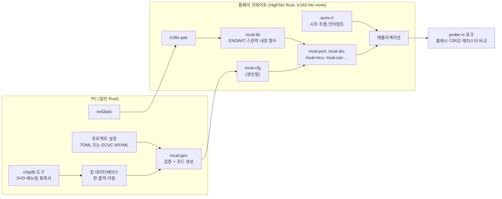

# AURIX 완전 Rust MCAL 검토

2026-11-01

## 요약

목표는 C 코드 없는 AURIX MCAL이다. 드라이버, 설정 생성기(EB tresos를 대신하는 것), 그 밖의 도구를 모두 Rust로 만든다. 첫 대상은 이 저장소의 TC36x 보드다. 저장소는 `D:\work\claude\aurix_mcal`이다.

- **할 수 있다.** AURIX의 MCAL 일은 결국 메모리 맵 레지스터를 정해진 순서로 쓰는 것이다. Rust는 레지스터 접근(PAC), 인라인 어셈블리(`asm!`), 링커 섹션(`#[link_section]`), `no_std`를 모두 지원한다. 기존 C MCAL에서도 어셈블리는 컴파일러 헤더와 공통 라이브러리 두 곳에만 모여 있다. 생성기와 도구는 PC에서 돌므로 일반 Rust(이 PC의 1.99)로 바로 만들 수 있다.
- **첫 관문은 TriCore용 Rust 컴파일러다.** 지금 쓸 수 있는 것은 HighTec Rust 컴파일러(상용, LLVM 기반, 대상 `tc162-htc-none`, 평가판 있음)뿐이다. 업스트림 rustc·LLVM에는 TriCore 대상이 없다. 오픈소스 LLVM TriCore 포크와 GCC 경로는 실험 수준이다. 그래서 HighTec으로 시작하되, 코드는 그 컴파일러에 묶이지 않게 짠다.
- **컴파일러 없이 PC 도구부터 만든다.** 생성기·편집기는 일반 Rust로 만들고, 결과는 PC에서 검증한다. 생성된 설정은 PC용 rustc로 타입 검사하고, 레지스터 값은 같은 설정을 넣은 Tresos 출력 값과 숫자로 비교한다. 컴파일러가 있어야 하는 것은 칩 위에서 드라이버를 돌리는 단계뿐이다.
- **칩 데이터는 Tresos 것을 쓸 수 없다.** Tresos의 칩 자원 정의(`.bmd`)와 설정 스키마(`.xdm`)는 Infineon·EB 것이다. 대신 Infineon이 배포하는 TC36x SPIRIT IO 설명(`TC36xpd_IO_Spirit_v100114.xml`)을 쓴다. 이 파일은 기계가 읽을 수 있는 핀 데이터라 Port 쪽 칩 데이터베이스를 손으로 옮기지 않아도 된다. 클럭 한계 같은 나머지는 매뉴얼에서 만든다. TC36x SVD는 아직 없다.
- **clean-room으로 만든다.** Infineon MCAL 소스는 서면 허가 없는 복제·전달이 금지돼 있다. 그 소스를 보고 옮기면 2차 저작물이 된다. 매뉴얼·SVD·데이터시트만 보고 새로 쓴다. 기존 MCAL은 범위(모듈 목록, 일의 크기)를 가늠하는 데만 썼다.
- **안전 근거는 우리가 만든다.** Infineon MCAL에는 요구사항 추적 태그 15,046개, MISRA 예외 근거, Safety 변형이 있다. 우리 MCAL은 이것을 처음부터 갖춰야 한다. 양산에 쓰려면 생성기도 ISO 26262 도구 인증 대상이다.
- **순서:**
    - 가) PC 도구(컴파일러 없이): Port → Mcu 클럭 계산 → CAN 비트 타이밍·메시지 RAM → 나머지 모듈의 설정과 생성.
    - 나) 칩 위(컴파일러가 생긴 뒤): 런타임·PAC와 깜빡이를 probe-rs 포크로 디버깅 → Port·Dio 드라이버 → Stm·Gpt·공통 라이브러리·Wdg → Mcu → CAN → 플래시(FlsLoader·Fls·Fee) → 나머지.
    - 모듈마다 PC에서는 Tresos 출력 값과, 보드에서는 C MCAL이 쓴 레지스터 값과 비교해 검증한다.
- **진행(2026-11-01):** 가)의 Port가 끝났다. 칩 데이터 읽기, 설정 모델과 검사, Port 레지스터 값 계산, 생성기 CLI, egui 편집기(EB tresos 화면 구성)다. EB 프로젝트 네 작업공간의 Port 설정(각 101핀)을 옮겨 Tresos 출력 값과 비교해 모두 같았다. 가2(Mcu 클럭 계산)도 되어, 같은 네 작업공간의 클럭 설정에서 PLL 필드·CCUCON 값이 Tresos와 같다. 가3(CAN)은 CAN 출력이 있는 작업공간에서 50개 값이 Tresos와 같다. 가4는 Wdg부터 했고, 네 작업공간(설정 두 가지)에서 26개 값이 같다. Spi는 네 작업공간(설정 한 가지)에서 58개 값이 같다(아래 "진행 상황").

## 목표와 범위

| 구분 | 만드는 것 | 대신하는 것 |
|---|---|---|
| 칩 위 | 런타임(시작 코드, 트랩·인터럽트, 멀티코어 시작), PAC, 공통 라이브러리, MCAL 드라이버 모듈, 생성된 설정 크레이트 | Infineon MC-ISAR(C), 컴파일러 시작 코드, iLLD |
| PC | 설정 생성기(모델, 칩 데이터베이스, 검증, 코드 생성), 칩 데이터베이스 작성 도구, 설정 편집기(나중) | EB tresos와 Infineon Tresos 플러그인 |
| PC·보드 | 플래시와 디버깅(probe-rs 포크, 이미 Rust), 레지스터 비교 도구, 보드 시험 실행기 | Lauterbach·UDE·MemTool 등의 일부 |
| 컴파일러 | HighTec Rust(사서 씀). 직접 만들지 않는다 | HighTec·Tasking C 컴파일러 |

범위 밖: AUTOSAR의 MCAL 위 계층(CanIf, PduR, OS, RTE 등). 다만 MCAL API를 그 계층에 맞출지는 정해야 한다(아래 "API 모양").

## 참고로 본 기존 MCAL

범위를 가늠하려고 EB tresos 프로젝트에 들어 있는 Infineon MC-ISAR TC3xx(AUTOSAR 4.2.2, 2021판)를 보았다. 위치는 `plugins/McalExt_TS_T16D29M1I0R0/MCAL_Delivery/McIsar`(양산 프로젝트 사본, 저장소에는 넣지 않음)다. 소스는 구조와 규모만 보았고, 우리 코드에는 옮기지 않는다.

- **규모:** 31개 모듈, 약 26만 줄(주석 포함). 부트로더가 쓰는 5개 모듈(Mcu, Port, Can_17_McmCan, FlsLoader, McalLib)이 약 5.3만 줄이고, 주석·빈 줄을 빼면 약 2.1만 줄이다. TC36x 레지스터 헤더만도 약 25.8만 줄인데, Rust에서는 PAC가 대신한다.
- **생성기:** 모듈마다 Tresos 플러그인이 있다. 설정 스키마(`.xdm`), 칩·패키지별 자원 정의(`.bmd`, 예: `TC364_LQFP`), C를 만드는 텍스트 템플릿으로 되어 있다. 생성 결과는 빌드 전 설정(`*_Cfg.h`의 `#define`)과 post-build 설정(`*_PBcfg.c`의 `const` 구조체)이다. post-build 설정은 미리 계산한 레지스터 값 표다(예: `CCUCON0`, PLL 분주비, K2 단계 지연). 우리 생성기도 같은 일을 Rust 코드로 하면 된다.
- **설정 분기:** 전처리기 `#if`가 Mcu 391개, Spi 333개, Can 222개다. Rust에서는 cargo feature와 생성된 `const`로 바뀐다.
- **통합 지점:** 크리티컬 섹션 `SchM_Enter_*`/`SchM_Exit_*` 84종, `Det_ReportError`, `MemMap.h` 섹션(코어별 변수 섹션 포함), SRC 인터럽트 설정, 안전 오류 보고.

### 모듈 크기

줄 수는 `.c`·`.h` 전체(주석 포함)다. 굵은 것이 부트로더에서 쓰는 모듈이다. 우리 MCAL의 일의 크기를 가늠하는 데 쓴다.

| 모듈 | 줄 수 | 모듈 | 줄 수 | 모듈 | 줄 수 |
|---|---:|---|---:|---|---:|
| Fee | 20,857 | **Mcu**(+TimerIp) | 20,405 | Icu_17_TimerIp | 17,820 |
| **Can_17_McmCan** | 15,865 | Adc | 15,826 | Fr_17_Eray | 12,800 |
| Eth_17_GEthMac | 12,677 | Spi | 12,488 | Fls_17_Dmu | 11,100 |
| Pwm_17_GtmCcu6 | 10,497 | Gpt | 10,366 | Dma | 7,768 |
| Bfx | 7,632 | **FlsLoader** | 7,080 | Smu | 6,897 |
| Dsadc | 6,413 | Hssl | 6,343 | Ocu | 6,196 |
| Lin_17_AscLin | 5,861 | CanTrcv_17_W9255 | 5,368 | **McalLib** | 5,246 |
| Crc | 4,685 | Uart | 4,462 | Wdg_17_Scu | 4,308 |
| **Port** | 4,276 | Iom | 2,925 | I2c | 2,767 |
| Dio | 2,737 | Sent | 2,376 | Stm | 2,246 |
| CanTrcv_17_V9251 | 2,151 | | | | |

C MCAL의 줄 수에는 AUTOSAR 오류 검사, 추적 주석, 네 컴파일러 분기가 많이 들어 있다. Rust판은 타입 검사가 그 일부를 대신해 더 짧아질 것이다. 하지만 하드웨어 순서와 예외 처리의 양은 같다.

## 전체 구성

크레이트 나눔 안:

| 크레이트 | 쪽 | 하는 일 |
|---|---|---|
| `aurix-rt` | 칩 | 리셋 진입, CSA 목록 초기화, 스택, `.data`·`.bss` 초기화, 트랩 표(BTV)와 인터럽트 표(BIV), 다른 코어 시작, 링커 스크립트 |
| `tc36x-pac` | 칩 | `svd2pac`로 만든 레지스터 접근. 칩마다 하나(TC37x, TC39x는 나중에) |
| `mcal-lib` | 칩 | ENDINIT(CPU·Safety 워치독 암호), 스핀락, 코어 번호, DSPR·PSPR 주소 변환, 지연 틱, `mtcr`·`mfcr`·`dsync`·`isync` 같은 내장 함수. 어셈블리는 이 크레이트에만 둔다 |
| `mcal-<모듈>` | 칩 | 모듈마다 하나. 생성된 설정 타입을 받아 동작한다 |
| `mcal-cfg` | 칩 | 생성기가 만든 프로젝트 설정(`const`·`static`). 사람이 고치지 않는다 |
| `mcal-model` | PC | 설정 모델(타입), 직렬화, 검증 규칙, 레지스터 값 계산. 생성기와 편집기가 함께 쓴다 |
| `mcal-chipdb` | PC | 칩·패키지별 자원 데이터와 그것을 읽는 코드(지금은 SPIRIT IO 설명) |
| `mcal-gen` | PC | CLI. 설정과 칩 데이터를 읽어 검증하고 `mcal-cfg`를 만든다 |
| `mcal-ui` | PC | egui 설정 편집기(EB tresos 구성) |
| `mcal-regcheck` | PC | probe-rs로 보드의 주변장치 레지스터를 읽어 기대값과 비교한다 |

## 컴파일러

| 방법 | 상태 | 판단 |
|---|---|---|
| HighTec Rust 컴파일러 | 상용, LLVM 기반, TC3x·TC4x. `cargo +tricore build --target=tc162-htc-none`. V1.0이 ISO 26262 ASIL D 인증이라고 발표했다(공급사 자료). 링커·`core` 라이브러리 포함, 평가판 있음 | **이것으로 시작** |
| 오픈소스 LLVM TriCore 포크로 rustc 직접 빌드 | [TriDis/llvm-tricore](https://github.com/TriDis/llvm-tricore), [FAU 논문](https://open.fau.de/handle/openfau/1108) 같은 실험 백엔드만 있고 오래됐다 | 컴파일러를 계속 손봐야 해서 이 과제와 따로 가야 할 만큼 크다 |
| rustc_codegen_gcc와 TriCore GCC | HighTec GCC 소스는 공개돼 있고 GCC 9 포팅도 있다고 한다. libgccjit 버전이 맞아야 하고, 이렇게 돌린 사례는 찾지 못했다([LLVM 포럼](https://discourse.llvm.org/t/targetting-tricore-in-llvm-toolchain/56885/5?u=xvilka)) | 연구 과제 수준 |

이 PC에는 HighTec GCC(C) v4.9.3.0과 Windows용 rustup(1.98.1·1.99.1·stable)만 있다.

컴파일러에 묶이지 않게 하는 규칙:

- 안정판 Rust 문법만 쓴다. HighTec 고유 속성은 `aurix-rt`와 `mcal-lib` 안에만 둔다.
- 어셈블리는 `mcal-lib`의 작은 함수들(`asm!`)에 모은다. 드라이버 모듈에는 어셈블리를 쓰지 않는다.
- 링커 스크립트와 섹션 이름은 우리 것으로 정한다. 컴파일러가 주는 기본값에 기대지 않는다.
- `no_std`, 할당자 없음, `panic = "abort"`. 패닉 처리기는 안전 오류 훅으로 간다.

## 칩 위 설계

### 런타임과 PAC

- **런타임:** TriCore는 시작할 때 CSA(문맥 저장 영역) 목록을 만들어야 함수 호출이 된다. 그래서 첫 코드는 어셈블리이거나, 호출을 쓰지 않는 Rust여야 한다. 트랩 표와 인터럽트 표는 정렬 규칙이 있는 고정 배치다. 코어마다 스택·CSA·로컬 변수(DSPR)를 따로 둔다. Bluewind의 Rust 드라이버와 Veecle 런타임이 참고가 되지만, 둘 다 TC37x용이고 2024년 이후 멈췄다.
- **PAC:** Infineon `svd2pac`(MIT, 활발함)로 만든다. TC36x SVD를 Infineon에서 받아야 한다. 공개 PAC는 TC375용(`Infineon/tc375-pac`) 하나뿐이다.
- **보호 레지스터:** 많은 SCU·클럭 레지스터는 ENDINIT를 연 동안에만 쓸 수 있다. PAC 위에 `mcal-lib`가 `with_cpu_endinit(|| …)`·`with_safety_endinit(|| …)` 같은 클로저 API를 주면, 닫기를 빠뜨릴 수 없다. 기존 MCAL은 ENDINIT 쓰기 함수를 57곳에서 부른다.

### C MCAL 개념의 Rust 대응

| C MCAL | 우리 Rust MCAL |
|---|---|
| `IfxXxx_reg.h` 구조체·비트필드 | PAC |
| 빌드 전 설정 `#if XXX == STD_ON` | cargo feature, 생성된 `const` |
| post-build 설정 `*_PBcfg.c` | 생성된 `static` 설정. 따로 링크해 나중에 바꿔 쓸 수 있게 섹션을 나눌 수 있다 |
| `Det_ReportError`, `E_OK`/`E_NOT_OK` | `Result<_, Error>`와 선택적 오류 훅 |
| `SchM_Enter_*`/`SchM_Exit_*` | 크리티컬 섹션 트레이트. OS 없이 쓸 때는 인터럽트 끄기로 구현 |
| `MemMap.h` 섹션, 코어별 변수 | `#[link_section]`과 우리 링커 스크립트 |
| ENDINIT 열고 쓰고 닫기 | 클로저 API |
| Irq 설정과 ISR | 생성된 SRC 설정과 인터럽트 함수 속성 |
| 핀·채널 번호(정수) | 생성된 타입 있는 핸들. 없는 핀이나 다른 모듈 소유의 핀을 컴파일 때 막는다 |
| 클럭 설정 순서 | 상태 타입(초기 → PLL 켜짐 → 목표 주파수). 순서를 어기는 호출은 컴파일되지 않는다 |
| `Mcal_SafetyError` | 안전 오류 훅. 근거 문서는 따로 |

### API 모양

정해야 할 것이다. 권장은 **Rust다운 API를 기본으로 하고, AUTOSAR 모양 C ABI 층은 선택**으로 두는 것이다.

- **Rust다운 API:** 소유권으로 자원을 나눈다(핀, CAN 노드, 타이머 채널). 설정은 생성된 타입으로 받는다. 오류는 `Result`다.
- **AUTOSAR 모양 층(선택):** `#[no_mangle] extern "C" fn Can_Write(…)`처럼 AUTOSAR SWS의 이름과 인자를 따른다. 기존 C 상위 계층(EB 스택 등)이나 AUTOSAR 도구와 함께 쓸 때만 필요하다. AUTOSAR 규격을 제품 개발에 쓰는 조건(AUTOSAR 파트너십)은 확인해야 한다.

## 생성기

Tresos가 하는 일을 Rust 프로그램으로 나눈다.

| 일 | Tresos | 우리 |
|---|---|---|
| 설정 스키마 | 모듈별 `.xdm` | `mcal-model`의 Rust 타입. `serde`로 읽고 쓴다. 필요하면 JSON Schema를 뽑아 편집기에 쓴다 |
| 칩 자원 | 칩·패키지별 `.bmd` | `mcal-chipdb`. 핀과 대체 기능, 패키지는 Infineon SPIRIT IO 설명에서 읽는다. 클럭 트리와 한계값, 모듈·채널 수는 매뉴얼에서 만든다 |
| 프로젝트 설정 | Tresos 프로젝트, ECUC ARXML | 기본은 TOML(사람이 읽고 git으로 관리). ECUC ARXML 읽기·쓰기는 나중에 가져오기·내보내기로 |
| 검증 | Tresos 검사 규칙 | Rust 검증 함수. 핀 중복, 클럭 한계, PLL 계산, CAN 비트 타이밍, 메시지 RAM 크기를 검사하고 위치와 함께 오류를 낸다 |
| 계산 | 템플릿 안의 계산 | Rust 함수. PLL 분주비 찾기, K2 단계, CAN 비트 타이밍, 메시지 RAM 배치. 단위 시험을 붙이기 쉽다 |
| 코드 생성 | 텍스트 템플릿 → C | `quote`·`prettyplease`로 Rust 코드(`mcal-cfg`)를 만든다. 같은 입력이면 같은 출력(재현 가능) |
| 화면 | Eclipse 기반 GUI | `mcal-ui`(egui). EB tresos와 같은 구성: Project Explorer 트리, 경로·탭이 있는 편집기, 표와 폼, Problems 창, Verify·Generate. 파라미터 이름은 AUTOSAR의 것(`PortPinDirection` 등) |

칩 데이터베이스가 가장 큰 일이다.

- **핀:** Infineon의 TC36x SPIRIT IO 설명(`04 TC36x Family/00 Hardware Documentation/08 SPIRIT IO Description`)에 다 있다.
    - 패키지 6종(LFBGA292, LFBGA180, LQFP144, LQFP176, TQFP144, BareDie)의 볼·리드 배치. QFP는 리드 번호가 `pin` 벡터로 들어 있다.
    - 포트 264개. 그 가운데 GPIO는 133개다.
    - 핀마다 대체 출력(`O1`–`O7`, 하드웨어가 잡는 `HWOUT1`), 대체 입력, 패드 종류(FAST·SLOW·RFAST …), 리셋 때 상태, 전원 도메인.
    - 이 파일은 Infineon 저작물이라 저장소에 넣지 않고, 프로젝트가 사용자가 둔 파일을 가리킨다.
- **나머지:** 레지스터 배치는 SVD에서 와야 하고, 클럭 한계 같은 값은 데이터시트와 사용자 매뉴얼의 표에서 와야 한다. 손으로 옮기면 틀리기 쉬우니, 매뉴얼 표(PDF에서 뽑은 텍스트)를 도구로 읽고 사람이 검토한다.
- 처음에는 TC364 한 칩만 한다.

생성 결과는 `cargo build` 전에 `mcal-gen`을 돌려 크레이트 파일로 쓴다(`build.rs`에서 돌리지 않는다). 생성된 코드가 git에 남아야 검토와 비교가 된다.

## 도구

| 도구 | 하는 일 | 상태 |
|---|---|---|
| probe-rs 포크 | TC36x 플래시, BP, 한 단계 실행, 콜스택, 메모리 보기 | 있음. HighTec LLVM이 내는 DWARF(TriCore 레지스터 번호, CFA 규칙, Rust 이름)와 맞는지는 1단계에서 확인 |
| `mcal-regcheck` | 초기화가 끝난 시점에 BP를 걸고 주변장치 레지스터를 읽어 기대값과 비교 | 새로 만든다. probe-rs 라이브러리 위에 얹는다 |
| 보드 시험 실행기 | 시험 펌웨어를 올리고 결과(RAM의 결과 블록이나 RTT 같은 로그)를 모은다 | 새로 만든다. Veecle `tricore-probe`의 defmt 방식이 참고가 된다 |
| `mcal-gen`, `mcal-chipdb` | 위 "생성기" | Port까지 있다 |
| `mcal-ui` | 설정 모델을 화면으로 편집(EB tresos 구성) | Port까지 있다 |

**검증 기준:** 두 단계로 한다. 어느 쪽도 C 소스를 보지 않는다.

- **PC(컴파일러 없이):** EB 프로젝트의 부트로더 설정을 우리 도구에 똑같이 넣고, 생성된 레지스터 값을 Tresos가 만든 값과 숫자로 비교한다. 예: `Port_PBcfg.c`의 핀 설정, `Mcu_PBcfg.c`의 `CCUCON0 = 0x17230113`과 PLL 분주비, CAN 비트 타이밍. 소스가 아니라 생성 결과의 값만 기준으로 쓴다.
- **보드(컴파일러가 생긴 뒤):** 같은 설정을 C MCAL과 우리 MCAL로 각각 빌드해 돌리고, 초기화 뒤의 주변장치 레지스터를 `mcal-regcheck`로 비교한다.

## 모듈 순서와 난이도

규모는 어림이다. 기준은 QM(안전 요구 없음) 품질로, 보드에서 C MCAL과 같은 레지스터 값이 나오는지까지다.

| 단계 | 모듈 | 난이도 | 이유 |
|---|---|---|---|
| 2 | Port, Dio | 작음 | 핀마다 `IOCR`·`OMR`·`PDR`. 생성기의 첫 대상으로 알맞다(핀 표, 검증, 코드 생성을 다 거친다) |
| 3 | Stm, Gpt(STM 기반) | 작음 | 비교 레지스터와 인터럽트. GTM·CCU6 기반 채널은 중간 |
| 3 | mcal-lib | 중간 | ENDINIT 암호 계산, 스핀락(`cmpswap.w`/`swapmsk.w`), 코어별 주소 변환 |
| 3 | Wdg_17_Scu | 중간 | ENDINIT와 같은 장치, 시간 제약 |
| 4 | Mcu | 큼 | PLL 켜기, K2 단계 변경(지연 포함), CCUCON 갱신 순서, 리셋 원인, 저전력. 순서를 틀리면 칩이 멈추거나 리셋된다 |
| 5 | Can(MCMCAN) | 큼 | 메시지 RAM 배치, 필터, 송수신 버퍼·FIFO, 인터럽트·폴링, 버스오프. 생성기에 비트 타이밍과 RAM 배치 계산이 들어간다 |
| 6 | FlsLoader, Fls, Fee | 큼 | DMU 명령 순서, RAM에서 도는 쓰기·지우기 코드, 보호(UCB·PROCON) 확인. 틀리면 플래시나 UCB를 망가뜨릴 수 있다. UCB는 쓰지 않는다는 지금 규칙을 코드로도 막는다 |
| 7 | Spi, Adc, Icu, Pwm, Dma, Eth, Fr, Lin … | 중간~큼 | 필요한 차례로 |

부트로더에 필요한 것은 5단계까지와 FlsLoader다.

## 안전과 품질

양산에 쓰려면 아래가 필요하다. 처음부터 자리를 잡아 두면 나중 비용이 줄어든다.

- **요구사항과 추적:** 모듈마다 요구사항 문서를 두고, 코드의 문서 주석에 요구사항 ID를 단다. 도구로 뽑아 추적표를 만든다.
- **코딩 규칙:** MISRA C를 대신할 규칙이 필요하다. `unsafe`는 PAC와 `mcal-lib`에만 허용하고, 쓸 때마다 이유를 적는다. clippy 규칙을 정하고, 패닉이 나지 않음을 보인다(인덱스·산술 검사).
- **시험:** PC에서는 가짜 레지스터로 단위 시험, 생성기의 계산·검증 시험. 보드에서는 `mcal-regcheck`와 동작 시험.
- **도구 인증:** 컴파일러는 HighTec 인증 키트(QKit)를 쓴다. 생성기는 우리 도구라, 출력을 매번 검증하지 않으려면 ISO 26262-8의 도구 인증을 우리가 해야 한다. 레지스터 비교로 출력을 검증하면 인증 수준을 낮출 수 있다.
- **`core` 라이브러리:** 인증 범위에 `core`가 들어가는지 HighTec에 확인한다.

## 라이선스

- **Infineon MCAL 소스:** 보지 않고 옮기지 않는다(clean-room). 범위 조사에 쓴 것은 모듈 목록과 줄 수, 구조뿐이다. 만드는 사람에게 MCAL 소스를 주지 않는 것이 안전하다.
- **Tresos의 `.xdm`·`.bmd`·템플릿:** 쓰지 않는다. 칩 데이터는 매뉴얼·데이터시트·SVD에서 만든다.
- **SVD와 매뉴얼:** Infineon 배포 조건 안에서 쓴다. SVD로 만든 PAC를 공개할지는 SVD 조건을 보고 정한다.
- **AUTOSAR:** AUTOSAR 모양 API를 만들면 AUTOSAR 규격 사용 조건(파트너십)을 확인한다.
- **우리 코드:** 사내 전용인지 공개할지 정한다.

## 위험과 관문

| 관문 | 영향 | 열 방법 |
|---|---|---|
| TriCore Rust 컴파일러 | 칩 위 모든 것 | HighTec 평가판으로 시작. 양산에는 상용 라이선스와 QKit. 업스트림 대안이 없어 공급사에 묶인다 |
| TC36x SVD | PAC, 따라서 칩 위 모든 것 | Infineon에 요청. 없으면 C 레지스터 헤더에서 뽑는 것도 생각할 수 있지만, 헤더도 Infineon 것이라 조건을 확인해야 한다 |
| 칩 데이터 | 생성기 | 매뉴얼·데이터시트 표를 도구로 뽑고 사람이 검토. 처음에는 한 칩, 한 패키지 |
| 안전 근거 | 양산 | 양산 ECU의 ASIL 요구를 먼저 정하고, 추적·시험·도구 인증 계획을 세운다 |
| 보드 위험 | Mcu, 플래시 모듈 | 보드를 잠그거나 플래시를 망가뜨릴 수 있다. 시험 뒤 리셋하고, UCB는 쓰지 않는다 |
| 일의 양 | 전체 | 부트로더에 필요한 모듈만 해도 Mcu·Can·플래시가 큰 쪽이다. 단계마다 보드 검증으로 끊어 간다 |

## 단계

### 가) PC 도구 (컴파일러 없이)

| 단계 | 관문 | 할 일 | 수용 기준 |
|---|---|---|---|
| 가1. Port | 없음 | `mcal-chipdb`(SPIRIT IO 읽기), `mcal-model`(설정·검사·레지스터 값), `mcal-gen`(CLI), `mcal-ui`(편집기), `mcal-port`의 설정 타입, `mcal-tresos`(Tresos 출력 비교) | **됨(2026-11-01).** 예제 프로젝트를 검사·생성하고, 생성된 크레이트가 빌드된다. EB 프로젝트 네 작업공간의 Port 설정이 Tresos 출력과 같다 |
| 가2. Mcu 클럭 | 데이터시트의 클럭 한계 | PLL 분주비에서 주파수, 도메인 주파수에서 CCU 분주비, SYSPLLCON·PERPLLCON·CCUCON 값. 편집기에 Mcu 모듈 | **됨(2026-11-01).** EB 프로젝트 네 작업공간의 `Mcu_PBcfg.c`와 PLL 필드 9개, CCUCON 4개, CPU 분주비 2개가 같다. 남은 것: K2 단계 변경 지연, FM 변조, 클럭 모니터, 외부 클럭 출력, RAM·저전력 설정 |
| 가3. CAN | 가2(클럭) | 비트 타이밍, 메시지 RAM 배치, 필터 | **됨(2026-11-01).** EB 프로젝트의 `Can_17_McmCan_PBcfg.c`와 50개 값이 같다. 남은 것: Rx FIFO와 마스크 필터, Tx FIFO/큐, CAN FD, 여러 비트 레이트, 인터럽트 노드 배정(ILE·SRC), 웨이크업 |
| 가4. 나머지 | 필요 | Dio, Gpt, Wdg, Fls … 설정과 생성. ECUC ARXML 가져오기·내보내기 | 모듈마다 같은 방식으로. **Wdg 됨(2026-11-01):** 네 작업공간의 `Wdg_17_Scu_PBcfg.c`와 26개 값이 같다. **Spi 됨(2026-11-02):** 네 작업공간의 `Spi_PBcfg.c`와 58개 값이 같다(네 곳의 `Spi.xdm`이 같아 설정은 한 가지). 다음 후보는 EB 프로젝트에 있는 FlsLoader |

### 나) 칩 위 (컴파일러가 생긴 뒤)

| 단계 | 관문 | 할 일 | 수용 기준 |
|---|---|---|---|
| 나0. 컴파일러 | HighTec Rust 평가판 | 설치하고 `tc162-htc-none`으로 빈 `no_std` 크레이트를 빌드 | ELF가 나오고, 섹션 배치를 우리 링커 스크립트로 정할 수 있다 |
| 나1. 런타임·PAC | 나0, TC36x SVD | `aurix-rt`, `tc36x-pac`, PAC만으로 LED 깜빡이와 STM 지연 | 보드에서 돈다. probe-rs 포크로 BP, 한 단계 실행, 콜스택, Rust 변수 보기가 된다 |
| 나2. Port·Dio | 나1, 가1 | 생성된 설정을 쓰는 Port·Dio 드라이버, `mcal-regcheck` | 보드에서 C MCAL과 Port 레지스터가 같다 |
| 나3. 기반 모듈 | 나2 | `mcal-lib`(ENDINIT·스핀락), Stm, Gpt, Wdg | 레지스터 비교와 동작 시험 통과. 워치독이 서비스되고, 멈추면 리셋된다 |
| 나4. 클럭 | 나3, 가2 | Mcu(PLL, CCUCON, 리셋 원인) | EB 부트로더와 같은 클럭 설정에서 CCU 레지스터가 같고, STM 주파수가 맞는다 |
| 나5. CAN | 나4, 가3 | Can(MCMCAN) | 보드에서 CAN 프레임을 주고받는다. CAN 레지스터와 메시지 RAM 배치가 C MCAL과 같다 |
| 나6. 플래시 | 나5 | FlsLoader, Fls, Fee | 정해 둔 시험 섹터만 지우고 쓴다. UCB 주소는 코드에서 거부한다 |
| 나7. 나머지 | 필요 | Spi, Adc, Icu, Pwm, Dma … | 모듈마다 같은 방식으로 |

## 진행 상황 (2026-11-01)

저장소 `D:\work\claude\aurix_mcal`([najari/aurix_mcal](https://github.com/najari/aurix_mcal), private)에 가1(Port)을 만들었다.

| 크레이트 | 된 것 |
|---|---|
| `mcal-chipdb` | SPIRIT IO 설명 읽기: 핀, 대체 출력(`O1`–`O7`·`HWOUT1`)·입력, 패드 종류, 리셋 상태, 패키지별 볼(BGA)·리드(QFP 벡터). TC36x 실제 파일과 직접 만든 가짜 칩 파일로 시험 |
| `mcal-model` | `project.toml` 모델(`[chip]`, `[generate]`, `[port.general]`, `[[port.pin]]`). 검사 규칙: 없는 핀, 패키지에 없는 핀, 중복, 이름, 입력 전용 핀, 없는 기능, `HWOUT1` 기능, 패드에 없는 드라이버, 같은 신호를 여러 핀에, Changeable과 API 설정의 어긋남. 레지스터 값: `PCx`(TC3xx 매뉴얼 Ports의 코딩), `PDx`(패드 종류별), `PLx`, `OUT`, 설정된 핀의 마스크 |
| `mcal-gen` | `pins`·`check`·`generate`(`--check`). 같은 입력이면 같은 출력. 기대 출력 시험은 생성된 코드를 시험 안에서 컴파일한다 |
| `mcal-ui` | egui 0.37 편집기. EB tresos 구성: Project Explorer(`Port` > `PortGeneral`, `PortConfigSet` > `PortContainer` > `PortPin`, 오류·경고 표시), 경로 표시와 모듈 탭, PortContainer 표(본딩된 핀 전부, 설정 안 된 핀은 흐리게, `+`로 추가), PortPin 폼(AUTOSAR 파라미터 이름, 해당 없는 항목은 흐리게, 설명은 마우스를 올리면), Pin Information(패드, 리드, 리셋 상태, 대체 기능 표), Problems(누르면 그 핀으로), Verify·Generate |
| `mcal-port` | 생성기가 채우는 설정 타입(`no_std`): `PortConfig`, `PortGeneral`, `PortInit`(`IOCR`·`PDR`·`OUT`·`PDISC`·마스크) |
| `mcal-mcu` | 클럭 설정 타입(`no_std`): `ClockConfig`(SYSPLLCON·PERPLLCON·CCUCON, CPU 분주비, 주요 주파수) |
| `mcal-spi` | SPI 설정 타입(`no_std`): `SpiConfig`(QSPI 모듈의 `PISEL`·`SSOC`, 채널, 장치의 `GLOBALCON.TQ`·`ECONz`·`BACON`, 작업, 시퀀스) |
| `mcal-wdg` | 워치독 설정 타입(`no_std`): `WdgConfig`(모드별 `REL`·`WDTCPUyCON1`, 트리거 ATOM 채널의 `CTRL`·주기·`IRQ_EN`) |
| `mcal-can` | CAN 설정 타입(`no_std`): `CanConfig`(모듈, 컨트롤러별 `NPCR`·`NBTP`·메시지 RAM 레지스터·`IE`와 필터 요소, 수신·송신 객체) |
| `mcal-tresos` | Tresos가 Infineon MCAL용으로 생성한 `Port_PBcfg.c`·`Port_Cfg.h`를 읽는다. 핀별 기호를 우리 설정으로 옮기고(`mcal-gen compare-tresos --write`), 같은 기호를 Tresos·Infineon 파일의 `#define` 숫자(`Port_PBcfg.c`, 드라이버의 `Port.h`)로 계산한 값과 우리 인코더 값을 핀마다 비교한다. 드라이버 코드는 보지 않고 생성 결과의 값만 쓴다 |

예제 `examples/tc364-tqfp144`: TC364 TQFP144에서 P20.8 `CAN00_TXD`(O5), P20.7 `CAN00_RXDB`, P33.4 GPIO 출력. `check` 0 오류, `generate`로 만든 `mcal-cfg`가 빌드된다. 보드의 실제 패키지는 아직 확인하지 않았다.

### SPI (2026-11-02)

- **자료:** 매뉴얼 QSPI 장의 보율과 지연 계산(`BR = fQSPI / ((TQ+1)(Q+1)(A+1+B+C))`, B와 C가 0이면 C는 1, 한 비트는 TQ 4개 이상; 지연 `4^PRE × (LEN+1)` 주기), 레지스터(`GLOBALCON.TQ` 7:0, `ECONz`의 `Q` 5:0·`A` 7:6·`B` 9:8·`C` 11:10·`CPH` 12·`CPOL` 13·`PAREN` 14, `BACON`의 `IPRE` 3:1 … `TRAIL` 18:16·`PARTYP` 19·`DL` 27:23·`CS` 31:28, `SSOC`의 `AOL` 15:0·`OEN` 31:16, `PISEL.MRIS` 2:0), 메모리 맵(QSPI0 `F000 1C00H`, 모듈마다 256바이트), TC36x SPIRIT의 QSPI0–3 신호.
- **모델(`[spi]`):** Tresos처럼 QSPI 모듈(`SpiHwConfigurationQspi`), 채널, 외부 장치, 작업, 시퀀스를 받는다. 동기 전송만 있다.
- **계산:**
    - 보율 인수는 오차가 가장 작은 것, 그다음 비트당 TQ 수가 가장 적은 것(TQ가 가장 큰 것), 그다음 `A+1+B+C`가 가장 짧은 것으로 고른다. Tresos의 5 Mbit/s(TQ 4, Q 1, A 0, B 0, C 1)와 1 Mbit/s(TQ 24)가 이 규칙과 같다. 맞지 않는 보율은 실제 값과 함께 경고한다.
    - `SSOC`는 장치들의 SLSO 허용과 극성, `ECONz`는 `cs % 8`에 둔다. 같은 ECON을 쓰는 두 장치(SLSOz, SLSOz+8)의 값이 다르면 오류다.
    - 검사: MRST 입력이 패키지의 핀에 있는지, SLSO가 칩에 있는지, Port 설정에 MRST 입력 핀과 SCLK·MTSR·SLSO 출력 핀이 있는지(경고), 이름 참조, 폭 2–32, 기본 데이터가 폭에 맞는지.
- **비교:** `mcal-gen compare-tresos-spi`. 작업·채널·시퀀스는 이름으로 맞춘다(드라이버 배열은 QSPI 순서). 작업마다 12개, 채널마다 6개, QSPI 모듈마다 5개, 시퀀스마다 2개, 모듈 지도와 개수 7개. 네 작업공간 모두 58개 값이 같다. 네 곳의 `Spi.xdm`이 같아서 설정은 한 가지다(QSPI1 SLSO3 1 Mbit/s와 QSPI0 SLSO2 5 Mbit/s).
- **비교하지 않은 것:** 시퀀스의 모듈 값(드라이버의 인코딩)과 SLSO0 스트로브 지연(외부 디멀티플렉서에서만 쓴다). 내부 버퍼 채널, 수동 보율 인수, 시간으로 주는 지연, 패리티, 여러 채널 작업은 이 설정에 없어 Tresos와 맞춰 보지 못했다.
- **편집기:** Spi 모듈(`SpiGeneral`, `SpiDriver` 아래 채널·장치·작업·시퀀스, `SpiHwConfiguration`). 장치 폼에 보율 인수, `ECONz`, `BACON`, 지연 시간(ns)을 계산 값으로 보인다. 진단은 `job Sbc`처럼 종류와 이름으로 가리킨다.
- **아직 없는 것:** 비동기 전송과 DMA, 외부 디멀티플렉서, GPIO 슬레이브 선택, 시간으로 주는 지연의 자동 계산, 여러 코어.

### 워치독 (2026-11-01)

- **자료:** 매뉴얼 SCU 장의 워치독 타이머(`WDTCPUyCON0`의 `REL` 31:16·`PW` 15:2, `WDTCPUyCON1`의 `IR0` 2·`DR` 3·`IR1` 5, 주기 = (0x10000 − REL) × 분주 / fSPB), GTM ATOM의 SOMP 모드 `CTRL`(`MODE` 1:0, `SL` 11, `CLK_SRC_SR` 14:12), TC36x 부록의 GTM 구성(ATOM0–3, 채널 8개씩).
- **모델(`[wdg]`):** CPU 워치독 하나다. Tresos처럼 기본 모드, 끌 수 있는지, 초기·최대 타임아웃, Slow·Fast 모드의 타임아웃과 새로 고침 주기, 트리거 ATOM 채널과 그 CMU 클럭을 받는다.
- **계산:**
    - Slow 모드는 fSPB / 16384, Fast 모드는 fSPB / 256으로 센다. `REL = floor(0x10000 − t × fSPB / 분주)`라서 주기는 `t` 이상이다. 카운터에 안 들어가는 타임아웃은 가능한 최댓값과 함께 오류로 낸다.
    - 트리거의 `CM0`·`SR0`는 새로 고침 주기 × CMU 클럭이다(24비트). `CTRL` = SOMP | SL | CMU_CLKn, `IRQ_EN`은 CCU0다. 새로 고침 주기가 타임아웃보다 짧아야 한다.
- **비교:** `mcal-gen compare-tresos-wdg`. 트리거 클럭은 `Mcu.xdm`의 fGTM 200 MHz / 클러스터 분주 2 / CMU_CLK0 분주 1 = 100 MHz로 옮긴다. 네 작업공간은 두 가지 설정이다. Slow 2 s(REL 53328)와 Slow 20 ms(REL 65413)이고, 둘 다 Fast 10 ms(REL 61629), 새로 고침 15/7 ms다. 네 곳 모두 26개 값이 같다.
- **비교하지 않은 것:** PBcfg의 타이머 번호 필드(인코딩이 드라이버의 것이고 값은 0)와 인터럽트 설정의 위 비트(0x81의 0x80, 드라이버의 인터럽트 모드). 허용 비트만 맞춘다.
- **편집기:** Wdg 모듈(`WdgGeneral`, `WdgSettingsConfig`, `GtmTimerConfiguration`). 모드별 `REL`, 실제 주기, 트리거 틱, 레지스터 값을 계산 값으로 보인다.
- **아직 없는 것:** CPU마다 여러 설정, 안전 워치독, STM 트리거, 외부 워치독, Mcu의 GTM 클럭(CMU) 모델. 트리거 클럭 주파수는 지금 직접 적는다.

### CAN (2026-11-01)

- **자료:** 매뉴얼 MCMCAN 장의 레지스터(`NPCR`, `NBTP`, `SIDFC`, `XIDFC`, `RXBC`, `RXESC`, `TXEFC`, `TXBC`, `TXESC`, `IE`)와 필터 요소(표준 `S0`, 확장 `F0`/`F1`), TC36x 부록 표 303·304(CAN0은 노드 4개와 32 KB RAM, CAN1은 노드 4개와 16 KB RAM, 노드 레지스터는 모듈 + `0x8100 + 0x400 × n`)와 노드별 수신 입력 연결.
- **모델(`[can]`):** Tresos처럼 컨트롤러는 노드, 수신 입력, 비트 레이트와 시간 양자(PropSeg, Seg1, Seg2, SJW)를 받는다. 클럭은 Mcu의 fMCAN이다. 하드웨어 객체 하나가 전용 버퍼 하나이고, 핸들은 수신 객체 다음 송신 객체다.
- **계산:**
    - 분주비 = fMCAN / (비트 레이트 × 양자 수). 정수가 아니면 맞는 양자 수 목록과 함께 오류를 낸다. `NBTP`의 범위(NTSEG1 2–256, NTSEG2 2–128, NBRP 1–512)를 확인한다.
    - 메시지 RAM은 모듈마다 노드 순서로, 노드 안에서는 표준 필터(4바이트), 확장 필터(8), Rx 버퍼(16), Tx 이벤트(8), Tx 버퍼(16) 순서로 놓는다. 노드와 RAM의 한계를 확인한다.
    - 수신 필터는 정확한 ID를 Rx 버퍼에 넣는 요소다(`SFEC`/`EFEC` = 111, 버퍼 번호는 `SFID2`/`EFID2`). `IE`는 Tx 이벤트(`TEFNE`), Rx 버퍼(`DRXE`), 버스오프(`BOE`) 중 인터럽트로 처리하는 것만 켠다.
- **칩·Port 검사:** 노드에 그 수신 입력이 있는 핀이 패키지에 있어야 한다. Port 모듈에 그 입력을 받는 입력 핀과 `CANxy_TXD` 출력 핀이 없으면 경고한다.
- **비교:** `mcal-gen compare-tresos-can`. 네 작업공간의 `Can.xdm`은 같은 설정(CAN01, 500 kbit/s, 수신 2개, 송신 1개)이고, 생성된 CAN 출력은 한 작업공간에만 있다. 그 작업공간에서 노드 주소, `NPCR`, `NBTP` = `0x0407_0E03`, 객체 범위, 메시지 RAM 주소 7개와 크기, 처리 방식, 폴링 마스크, `IE` = `0x0208_1000`, 필터 요소, Tx 객체, 모듈의 노드 사용까지 50개 값이 모두 같다.
- **아직 확인 못 한 것:** 이번 설정에 없어 Tresos 값과 맞춰 보지 못했다. 루프백(`NPCR.LBM`)의 인코딩, 확장 필터 요소, 폴링 마스크, 여러 컨트롤러가 메시지 RAM을 나누는 순서가 그렇다.
- **편집기:** Can 모듈(`CanGeneral`, `CanConfigSet` > `CanController`, `CanHardwareObject`). 컨트롤러 폼은 노드와 수신 입력(그 입력의 핀과 함께), 비트 타이밍, 계산된 분주비·샘플 포인트·메시지 RAM 주소·레지스터 값을 보인다. 객체 폼은 핸들, 버퍼, 필터 요소를 보인다.
- **아직 없는 것:** Rx FIFO와 마스크 필터, Tx FIFO/큐, CAN FD(데이터 단계 비트 타이밍, 큰 요소), 컨트롤러당 여러 비트 레이트, 인터럽트 노드 배정(ILE, SRC), 웨이크업, Pretended Networking, TTCAN.

### 클럭 계산 (2026-11-01)

- **자료:** 매뉴얼 Clocking System 장의 식과 레지스터(SYSPLLCON0/1, PERPLLCON0/1, CCUCON0/1/2/5, CCUCON6 이후 CPU 분주비), TC36x 데이터시트 표 3-3(도메인 최대 주파수)과 표 3-35·3-36(fREF 10–40 MHz, fDCO 400–800 MHz).
- **모델(`[mcu]`):** Tresos처럼 PLL 분주비(P, N, K2, K3, 1.6/2 분주, fsource1 = fPLL1/2)는 직접 받고, 클럭 도메인은 주파수로 받는다. 분주비는 매뉴얼 식의 값(N)이고 레지스터 필드는 N − 1이다.
- **계산:**
    - 도메인마다 CCU가 가진 분주비(1, 2, 3, 4, 5, 6, 8, 10, 12, 15)에서 맞는 값을 찾는다.
    - GTMDIV = 1은 2 × fSPB라는 규칙(매뉴얼 식 10.8), FSIDIV 2·3은 SRIDIV 1·2일 때만이라는 제약, CPU 분주비 `fSRI × (64 − n) / 64`를 지킨다.
    - 맞는 분주비가 없으면 가능한 주파수 목록과 함께 오류를 낸다.
- **칩별 규칙:** TC36x에는 EBU·HSPDM이 없어, 그 클럭 비트(`CCUCON2.EBUPERON`, `HSPDMPERON`)는 리셋 값(켜짐)으로 둔다. Tresos 출력도 그렇다.
- **비교:** 사용자 설정(`config/Mcu.xdm`)을 옮겨 계산한 값과 `Mcu_PBcfg.c`를 맞췄다(`mcal-gen compare-tresos-mcu`). 네 작업공간 모두 매뉴얼의 300 MHz 설정(fPLL0 300, fPLL1 320, fPLL2 200, fSRI 300, fSPB 100, fGTM 200, fMCAN 80, fQSPI 100 MHz)이고, 15개 항목이 모두 같다. 예: `CCUCON0 = 0x17230113`, `CCUCON1 = 0x22000012`, `CCUCON2 = 0x05000001`, `CCUCON5 = 0x30`.
- **편집기:** Mcu 모듈(`McuGeneralConfiguration`, `McuClockSettingConfig`의 시스템 PLL·주변 PLL·분배). 계산된 주파수(fDCO, fPLL, fsource, fADC, fERAY, fHSCT, CPU)를 Tresos의 계산 파라미터처럼 보이고, 레지스터 값을 접어서 보인다.
- **아직 없는 것:** K2 단계 변경 지연, 시스템 PLL FM 변조, 클럭 모니터, 외부 클럭 출력(FOUT), 백업 클럭 K 분주비, CCUCON3/4(REFCLK), RAM 초기화·저전력 모드 설정.

### Tresos 출력과의 비교 (2026-11-01)

EB 프로젝트의 네 작업공간의 Port 설정을 옮겨 비교했다.

- **포트:** Tresos 설정의 포트는 14개(0, 2, 10, 11, 13, 14, 15, 20, 21, 22, 23, 32, 33, 40)다. SPIRIT IO 설명의 TQFP144 포트와 같다. 이 양산 ECU는 TQFP144다.
- **비교 결과:** 작업공간마다 101핀 전부가 같았다(IOCR, PDR, OUT, PDISC, mode·direction changeable). 옮긴 설정은 검사 오류·경고가 없었다.
- **들어간 설정:** 출력 45개(그중 대체 기능 16개: QSPI MTSR·SCLK·SLSO, GTM TOUT, CAN TXD), 입력 56개(pull-down 35개), HIGH 레벨 5개, 아날로그 입력 전용 10개(P40)다. 드라이버 세기, TTL 레벨, open-drain, Changeable 핀은 이 설정에 없어 단위 시험으로만 확인했다.
- **이번에 더한 것:** 아날로그 입력 전용(`PortPinEnableAnalogInputOnly`, `Pn_PDISC`). P40 설정이 이것을 써서 모델·생성기·비교·편집기에 넣었다.
- **아직 모델에 없는 것:** PCSR(이 설정에서는 모두 0), 비상 정지(켜진 핀 없음), LVDS, 방향을 바꿀 때 쓰는 두 번째 port control 값, 대체 입력 신호 이름(Tresos 출력에 없음). 이 설정에서는 값의 차이로 이어지지 않는다.
- **동작 차이:** Infineon 드라이버는 설정된 포트의 16핀을 다 쓰고, 설정하지 않은 핀에는 `PORT_PIN_DEFAULT`(입력 pull-up)를 쓴다. 우리 설정은 설정된 핀만 마스크로 쓰고 나머지는 리셋 값으로 둔다. 비교는 설정된 핀만 한다.
- 옮긴 설정 파일은 고객 프로젝트의 핀 이름이 들어 있어 저장소에 넣지 않았다(`*.local.toml`).

## 확인할 것

- HighTec Rust 평가판의 조건과 양산 라이선스 비용, 인증서의 범위(컴파일러만인지, `core` 라이브러리까지인지).
- TC36x SVD를 받을 수 있는지, 그 배포 조건.
- 양산 ECU의 ASIL 요구.
- API 모양: Rust다운 API만으로 갈지, AUTOSAR 모양 층도 둘지. AUTOSAR 규격 사용 조건.
- 설정 형식: TOML만으로 갈지, ECUC ARXML 호환이 처음부터 필요한지.
- 이 보드(TriBoard)의 TC36x 패키지. 예제는 EB 양산 ECU와 같은 TQFP144로 두었다.
- 우리 코드의 공개 범위.
- HighTec LLVM의 TriCore DWARF가 probe-rs 포크의 언와인더와 맞는지(1단계에서 확인).

## 근거 자료

- Infineon MC-ISAR TC3xx 소스, Tresos 플러그인, 생성된 설정: EB tresos 프로젝트(양산 프로젝트 사본, 저장소에는 넣지 않음)의 `plugins/McalExt_TS_T16D29M1I0R0`와 `workspace/*/output/generated`. 규모와 구조만 보았다.
- HighTec: [AURIX Rust Startup Ecosystem](https://hightec-rt.com/aurix-rust-startup-ecosystem), [ASIL D Rust 컴파일러 발표](https://international.electronica-azi.ro/?p=40073), [C/C++ 컴파일러 ASIL D(2025-07)](https://www.electropages.com/2025/07/latest-cc-compiler-achieves-iso-26262-asil-d-certification-infineon-aurix)
- Infineon: [Rust 개발 플랫폼](https://infineon.com/cms/en/product/promopages/rust), [svd2pac](https://github.com/Infineon/svd2pac), [tc375-pac](https://github.com/Infineon/tc375-pac)
- Infineon TC36x 자료(사용자가 `D:\work\claude\infineon`에 둔 사본, 저장소에는 넣지 않음): SPIRIT IO 설명 `TC36xpd_IO_Spirit_v100114.xml`, TC3xx User's Manual의 Ports 장(`PCx` 코딩, 패드 드라이버 모드, 패드 레벨)
- EB tresos의 Infineon Port 플러그인 설정 구조(`Port_Aurix2G/config/AS422/Port.xdm`): 컨테이너와 파라미터의 계층과 이름만 편집기 구성에 참고했다
- Bluewind: [bw-r-drivers-tc37x](https://github.com/bluewind-embedded-systems/bw-r-drivers-tc37x), [예제](https://github.com/bluewind-embedded-systems/bw-r-drivers-tc37x-examples)
- Veecle: [tricore-probe](https://github.com/veecle/tricore-probe)
- Elektrobit: [Rust + AUTOSAR Classic 묶음(2025-07, TC4x, MCAL은 Infineon C)](https://www.elektrobit.com/?p=45527)
- 오픈소스 TriCore 컴파일러: [TriDis/llvm-tricore](https://github.com/TriDis/llvm-tricore), [FAU: TriCore Backend for LLVM](https://open.fau.de/handle/openfau/1108), [LLVM 포럼: Targetting Tricore](https://discourse.llvm.org/t/targetting-tricore-in-llvm-toolchain/56885/5?u=xvilka), [rustc_codegen_gcc](https://github.com/lordshashank/rustc_codegen_gcc)
