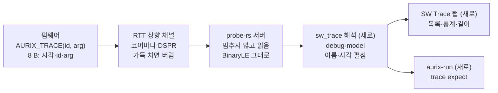

# AURIX 소프트웨어 트레이스 검토 (aurixtracing)

2026-10-26. Claude Docs 원본: [AURIX 소프트웨어 트레이스 검토 (aurixtracing)](https://claude.ai/artifact/1Htpb2E9wqxnEtWrTmEXo7)

## 결론

[mziccard/aurixtracing](https://github.com/mziccard/aurixtracing/tree/master)는 그대로 쓸 수 없지만, 방식은 가져올 만하다. 2015년 MCD API로 만든 호스트 데몬 하나뿐이고 타깃 쪽 코드가 없다. 하지만 "펌웨어가 RAM 링 버퍼에 (id, 시각)을 남기고 디버거가 코어를 멈추지 않고 읽는" 소프트웨어 이벤트 트레이스는 TRACE32 LOGGER와 같은 개념이다. ED가 아닌 우리 TC275 보드에서 MCDS 없이 얻을 수 있는 유일한 트레이스다.

- 권장: 앱 B에 "SW Trace" 탭을 둔다. 타깃은 작은 C 헤더로 기록하고, 전송은 이미 세 코어에서 되는 RTT 이진 채널을 쓴다. 서버는 고치지 않는다.
- 처리량은 어댑터 6 MHz에서 이론상 초당 약 1만 이벤트다. 태스크 전환·ISR 기록에는 넉넉하고, 함수마다 남기는 기록에는 모자란다.
- 이 저장소의 코드나 형식을 그대로 옮기지는 않는다(MIT 라이선스라 막히지는 않음). 넘침 처리, 블록 읽기, 심볼로 찾는 버퍼를 우리 식으로 새로 정한다.

## 구현 결과 (2026-10-26)

제안의 네 단계를 모두 만들었고 보드(TC275 CPU0, RAM 펌웨어)에서 확인했다. 전송은 A안(RTT 이진 채널)이고, 서버는 고치지 않았다.

| 단계 | 만든 것 | 보드 결과 |
| --- | --- | --- |
| 1. 타깃 헤더 | `zed/aurix_tcf_demo/src/aurix_trace.h`: 8 B 기록, 끝 비트, 빠진 수 기록, `DISABLE`/`RESTORE`로 인터럽트를 막고 쓴다. 자체 RTT 블록을 두거나 기존 버퍼에 붙는다. ORTI 데모는 `build_orti.ps1 -Trace`로 `orti_trace.elf`가 된다 | 버퍼를 직접 읽어 확인: ISR 시작이 1,000,000틱(10 ms)마다, ISR 하나가 약 275틱(2.75 µs) |
| 2. 해석 모듈 | `debug-model`의 `sw_trace`: `0xNN` 글자를 바이트로, 읽기 경계에 걸친 기록 이어 붙이기, 32비트 타이머 한 바퀴 펼치기, 이름 파일, 통계. 빠짐 기록을 지나는 간격·길이는 버린다 | 단위 테스트 5개 |
| 3. SW Trace 탭 | 앱 B: id별 횟수·간격·길이, 최근 이벤트 300개, 빠진 수, Freeze·Clear. 이진 채널은 RTT 탭에서 뺀다 | 태스크 슬라이스 400.00 ms(1.200 s마다), 타이머 ISR 10.00 ms마다 2.75–4.94 µs, dispatch 400.01 ms마다 |
| 4. 스크립트 | `aurix-run`의 `trace expect`·`trace clear`, `script/examples/sw_trace.aurix` | 9/9. 일부러 틀린 기대값은 실패로 보고했다 |

알게 된 것

- 아무도 읽지 않는 동안 타깃 버퍼(2 KiB)가 차서 기록이 빠진다. 붙은 직후에 오는 것은 오래된 기록이라, 스크립트는 `sleep 1s` 뒤 `trace clear`로 버린다. 탭은 빠짐 기록을 지나는 간격을 버리므로 통계가 흐트러지지 않는다.
- 연결된 동안에는 빠진 기록이 없었다(초당 약 200 기록, 버퍼 2 KiB).
- **두 코어와 읽기 주기(2026-10-26):** CPU1에 초당 2,200 기록(17.6 KB/s)을 쓰는 `trace_cpu1`을 더해 두 코어를 함께 읽었다(`sw_trace_2cores.aurix` 11/11, 빠짐 0). 타깃이 남긴 최대 사용량(`aurix_trace_high`)은 CPU1 192 B, CPU0 104 B였다. 읽는 간격으로 치면 CPU1 약 11 ms, CPU0 약 60 ms다. 서버는 데이터가 있으면 쉬지 않고, 없으면 50 ms 쉬고 다시 읽는다. 이 속도라면 버퍼 크기는 "초당 바이트 × 0.1 s"의 두 배면 넉넉하다.
- **차트(2026-10-26):** SW Trace 탭에 10 ms·100 ms·1 s·5 s 창의 차트를 더했다(TRACE32 Trace.Chart). 코어·id마다 한 줄, 길이는 막대, 단일 기록은 눈금이다. 두 코어 보드에서 5 s 창에 TaskA·B·C가 0.4초씩 번갈아 돌고, 10 ms 창에 CPU1의 100 µs 작업 10개와 5 ms 간격 샘플 2개가 나왔다. 기록이 초당 2,400개일 때 앱이 이벤트마다 창 전체를 다시 그리고 목록 300줄을 모두 만들어 UI가 굼떴다. 그래서 트레이스 데이터는 0.25초에 한 번만 다시 그리고, 목록은 보이는 줄만 그리게(`uniform_list`) 고쳤다.
- **차트 이동(2026-10-26):** 차트의 ◀ ▶가 창을 반씩 앞뒤로 옮기고 Latest가 최신으로 돌아온다. Freeze와 함께 쓰면 멈춰 둔 기록(최대 2만 개)을 훑는다. 보드에서 1 s 창을 두 번 뒤로 옮기자 10.497–11.497 s가 나왔고, 앞 창과 TaskC 막대가 이어졌다.
- **ORTI와 연결(2026-10-26):** 트레이스 id 이름이 ORTI 객체 이름과 같으면(`TaskA`, `TimerIsr`) 앱 B의 OS 탭 표에 "Load (trace)"와 "Last run (trace)" 칸이 붙는다. 보드에서 TaskA 34.29 %, TaskB 33.90 %, TaskC 30.48 %, 마지막 실행 각 400.00 ms였다. 그래서 데모의 ISR id 이름을 `timer_isr`에서 ORTI 객체 이름 `TimerIsr`로 바꿨다.
- **부하와 CSV(2026-10-26):** id마다 부하(마지막 빠짐 이후, 구간 길이의 합 ÷ 측정 시간)를 통계 표와 `trace expect … load`로 보인다. 보드에서 CPU1 job 10.01 %, CPU0 TaskA·B·C 30.5–34.9 %(셋이 합쳐 약 99 %), 타이머 ISR 0.03 %였다. 탭의 Save CSV와 `trace save <file>`이 이벤트를 `time_ns,core,id,name,kind,arg,span_ns`로 남긴다(`sw_trace_2cores.aurix` 16/16).
- **CPU1 RAM 프로그램의 자리:** 처음에 CPU1 데이터를 DSPR `0x60004000`에 두었더니 CPU1이 컨텍스트 트랩(class 3, `FCX = 0`)에 빠졌다. 그 자리에는 플래시 프로그램이 먼저 만든 CSA(컨텍스트 저장 영역, `LCX = 0xD0004080`)가 있었다. 데이터를 `0x6000A000`으로 옮겨 해결했다.
- ORTI 데모 소스가 늘어 `orti_paths.aurix`의 BP 줄을 85에서 107로 고쳤다(15/15).
## 저장소 내용

호스트 데몬 하나(`src/aurix_tracing.cpp`, 360줄)와 MCD API 도우미가 전부다. 마지막 커밋은 2015-04-14(`9f31d0a`), MIT 라이선스, C++에 Boost program_options, MSVC2010 프로젝트다. Infineon `mcdxdas.dll`로 miniWiggler V3에 붙는다. 펌웨어가 버퍼에 쓰는 코드는 없다.

코어마다 로컬 DSPR `0xD0000000`(기본값)에 링 버퍼가 있다고 본다.

| 오프셋 | 크기 | 내용 | 누가 쓰나 |
| --- | --- | --- | --- |
| 0 | 2 B | 읽기 인덱스 | 호스트 |
| 2 | 2 B | 쓰기 인덱스 | 타깃 |
| 4 + 12 n | 4 B | 항목 n의 id | 타깃 |
| 8 + 12 n | 8 B | 항목 n의 타임스탬프 | 타깃 |

항목은 1024개(12 KiB)다. 호스트는 다음을 되풀이한다.

1. MCD 서버를 찾거나 띄우고, 장치를 고르고(여럿이면 `scanf`), 코어를 모두 연다.
2. 코어마다 상태와 PC를 읽고, 읽기·쓰기 인덱스를 각각 16비트로 읽는다.
3. 새 항목마다 id(4 B)와 타임스탬프(8 B)를 따로 읽어 `trace_coreN.txt`에 `id 타임스탬프` 한 줄로 쓴다.
4. 읽기 인덱스를 타깃 RAM에 써 넣고, `--polling-period`(기본 1000 µs)만큼 잔다.

코어는 멈추지 않는다. 옵션은 버퍼 주소, 주기, 출력 이름, 코어 0만 읽기다.

## 문제점

| 문제 | 내용 | 우리 설계에서 |
| --- | --- | --- |
| 느린 읽기 | 항목마다 MCD 요청 2번(4 B + 8 B), 인덱스도 따로 2번. 버퍼를 한 번에 읽지 않는다 | 새 구간을 한 번에 읽는다(RTT, 또는 `readRanges`) |
| 넘침을 모름 | 꽉 차면 어떻게 하는지 규약이 없다. 타깃이 한 바퀴 앞지르면 기록이 말없이 사라지거나 뒤섞인다 | 가득 차면 버리고 버린 수를 센다. 화면에 빠진 수를 보인다 |
| 주기 계산 | `sleep(polling_period / 1000)`이라 1000 µs 미만은 0 ms다. Windows `Sleep`은 1 ms를 줘도 15 ms 안팎이다 | 서버의 RTT 읽기 주기를 그대로 쓴다 |
| 고정 주소 | 버퍼가 DSPR 맨 앞 `0xD0000000`에 고정이라 링커 배치와 부딪히기 쉽다 | RTT 제어 블록처럼 ELF 심볼로 찾는다 |
| 해석 없음 | id와 숫자 시각만 텍스트 파일로 남긴다. 이름·간격·길이는 없다 | id 이름, 간격 통계, 시작·끝 짝의 길이를 보인다 |
| 코드 품질 | 무한 루프라 파일이 닫히지 않고, `assert`로 오류를 막고, 장치 선택은 `scanf`다. 쓰지 않는 리셋·트리거 설정이 남아 있다 | 새로 쓴다 |

잘한 점도 있다. 항목을 쓴 뒤 인덱스를 올리는 단일 생산자·단일 소비자 구조라 잠금이 필요 없다. DSPR은 캐시되지 않아 디버거가 읽는 값이 코어와 같다. 타임스탬프를 STM 같은 공통 타이머로 남기면 코어끼리 시간이 맞는다.

## 비교

세 도구 모두 펌웨어가 RAM에 남긴 기록을 디버거가 읽는 소프트웨어 트레이스다. 다른 점은 해석과 전송이다.

| 항목 | TRACE32 LOGGER | aurixtracing | 우리 디버거(지금 → 제안) |
| --- | --- | --- | --- |
| 타깃 코드 | Lauterbach가 주는 로거 코드 | 없음 | 없음 → 작은 C 헤더 |
| 버퍼 찾기 | 심볼 | 고정 주소 | RTT 제어 블록(심볼) |
| 전송 | 디버거 메모리 읽기 | MCD, 항목마다 요청 2번 | probe-rs RTT, 버퍼를 묶어 읽음 |
| 코어 | 코어마다 | 코어마다(로컬 DSPR) | 코어마다(RTT, 세 코어 확인됨) |
| 넘침 | 표시 | 없음 | 버린 수를 센다 |
| 화면 | Trace.List, 차트, 통계 | 텍스트 파일 | 없음 → SW Trace 탭(목록, 통계, 길이) |
| 자동화 | PRACTICE | 없음 | `aurix-run` → `trace expect` |

TRACE32 칸은 Lauterbach 자료를 기억으로 적은 것이다. 이번에 따로 확인하지 않았다.

MCDS(하드웨어 트레이스)와는 겹치지 않는다. MCDS는 코드를 고치지 않고 모든 명령을 보지만 ED 보드가 있어야 한다. 소프트웨어 트레이스는 펌웨어에 기록을 넣어야 하고 넣은 곳만 보지만, 어느 보드에서나 된다.

## 제안 설계

앱 B에 "SW Trace" 탭을 둔다. 펌웨어가 RTT 상향 채널에 8바이트 기록을 남기면, 클라이언트가 이를 풀어 보인다.

펌웨어 기록은 기존 RTT 경로로 앱까지 간다. 서버는 고치지 않는다.

**타깃 쪽.** 헤더 하나(`aurix_trace.h`)에 `AURIX_TRACE(id, arg)`를 둔다.

- 기록은 8 B다: STM0 `TIM0`(32비트, 100 MHz면 10 ns 단위, 42.9초마다 한 바퀴) 4 B, id 2 B, arg 2 B. aurixtracing의 12 B보다 1.5배 많이 나른다. 한 바퀴는 호스트가 순서로 펼친다.
- id의 맨 윗 비트는 끝 표시다. `BEGIN(id)`와 `END(id)`가 짝이 되어 길이를 잔다.
- RTT 채널은 "가득 차면 버림" 모드다. 버린 수를 세어 두었다가 자리가 나면 "N개 빠짐" 기록을 하나 남긴다.
- 한 기록은 인터럽트를 막고 쓴다(코어마다 제 채널이라 코어 사이 잠금은 필요 없다).

**전송.** 두 안을 비교했다.

| 안 | 좋은 점 | 나쁜 점 |
| --- | --- | --- |
| A. RTT 이진 채널(권장) | 세 코어 RTT가 이미 된다. 서버 수정 없음. attach 파일의 채널 형식을 `BinaryLE`로 두면 서버가 바이트를 그대로 넘긴다 | 바이트가 `0x01`처럼 글자 4개로 와서 DAP 메시지가 4배다. 나중에 base64로 바꿀 수 있다 |
| B. 전용 링 버퍼 + `readRanges` | 형식을 마음대로 정한다. 읽는 주기를 앱이 정한다 | 인덱스를 타깃에 써 넣어야 한다. 버퍼 주소를 ELF에서 찾는 코드가 따로 필요하다 |

**호스트 쪽.**

- `debug-model`에 `sw_trace` 모듈을 둔다. RTT 바이트를 8 B 기록으로 자르고, 시각을 펼치고, id를 이름으로 바꾼다. 이름은 attach 파일 옆 `<attach>.trace`(`id = 이름`)에서 읽는다.
- SW Trace 탭은 최근 이벤트 목록(시각, 코어, 이름, arg, 앞 이벤트와의 간격), id별 통계(횟수, 최소·평균·최대 간격), 짝의 길이(태스크 실행 시간, ISR 길이), 빠진 수를 보인다.
- `aurix-run`에 `trace expect`를 더한다. 예: `trace expect 0 timer_isr count >= 50 within 1s`, `trace expect 0 TaskA duration <= 450ms`.

## 처리량

상한은 어댑터가 정한다. 보드 내장 DAS 어댑터 6 MHz에서 메모리 읽기는 131 KiB/s다(2026-10-25 측정). 8 B 기록이면 이론상 초당 약 16,000개다. 세 코어와 Live Watch·메모리 탭이 이 대역을 나눠 쓰므로 실제로는 그보다 적다.

- **얼마나 남길 수 있나:** 태스크 전환, ISR 진입·끝, 드문 상태 변화에는 넉넉하다. 1 ms 주기 함수 다섯 개에 BEGIN·END를 모두 남겨도 초당 10,000개라 상한에 가깝다. 함수마다 남기는 기록은 MCDS의 일이다.
- **버퍼 크기:** 읽는 간격 동안 쌓이는 양의 두 배는 되어야 빠지지 않는다. 예를 들어 2 KiB(기록 256개)를 100 ms마다 읽으면 초당 1,280개까지 빠짐없이 받는다. probe-rs 서버의 실제 RTT 읽기 간격은 재야 한다.
- **시험 펌웨어의 양:** ORTI 데모는 태스크 전환이 0.4초마다, 타이머 ISR이 10 ms마다 있다. BEGIN·END를 모두 남겨도 초당 약 200개(1.6 KB/s)다.
- **타깃 부담:** 기록 하나는 STM 읽기, 8 B 복사, 인덱스 갱신이다. 몇 사이클인지는 보드에서 `CCNT`로 재서 적는다.

## 단계와 보드 시험

네 단계로 나눈다. 모두 RAM 펌웨어만 쓰고 플래시는 건드리지 않는다.

| 단계 | 내용 | 끝났다고 보는 기준 |
| --- | --- | --- |
| 1. 타깃 헤더 | `aurix_trace.h`: 기록, 끝 표시, 버린 수. ORTI 데모의 `os_dispatch`와 `timer_isr`에 넣는다 | 데모가 전처럼 돈다(`orti_paths.aurix` 15/15). 기록 하나의 사이클을 `CCNT`로 잔다 |
| 2. 해석 모듈 | `debug-model`의 `sw_trace`: 바이트 → 기록, 시각 펼침, 이름 파일, 통계, 짝의 길이 | 단위 테스트: 기록이 두 이벤트에 걸쳐 와도, 타이머가 한 바퀴 돌아도 맞다 |
| 3. SW Trace 탭 | 앱 B의 목록·통계·길이·빠진 수 | 보드에서 TaskA·B·C가 각각 약 0.4초, 타이머 ISR 간격이 약 10 ms로 나온다 |
| 4. 스크립트 | `aurix-run`의 `trace expect`(횟수, 길이, 간격) | 보드 스크립트 `sw_trace.aurix`가 통과하고, 일부러 틀린 기대값은 종료 코드 1로 끝난다 |

열린 질문

- probe-rs 서버가 RTT를 얼마나 자주 읽는가(버퍼 크기를 여기서 정한다).
- 이름 파일 대신 펌웨어의 C `enum`을 ELF 디버그 정보에서 읽을 것인가.
- ORTI 파일이 있으면 태스크 id를 ORTI 태스크 이름으로 바로 보일 것인가.

## 출처

- [mziccard/aurixtracing](https://github.com/mziccard/aurixtracing/tree/master): `9f31d0a`(2015-04-14)를 받아 `README.md`, `src/aurix_tracing.cpp`, `src/mcd_utils.cpp`, `src/mcd_loader_class/mcd_loader_class.cpp`를 읽었다.
- probe-rs 포크(`tricore` 브랜치, `1839a18`): `util/stream_decoder.rs`(BinaryLE는 바이트를 `0xNN`으로 넘김), `cmd/dap_server/server/debug_rtt.rs`, `session_data.rs`(채널 형식 선택).
- 메모리 속도 131 KiB/s: 우리 측정(2026-10-25, `dap_measure`, 6 MHz).
- TRACE32 LOGGER: Lauterbach 자료를 기억으로 적음. 이번에 열어 확인하지 않았다.
