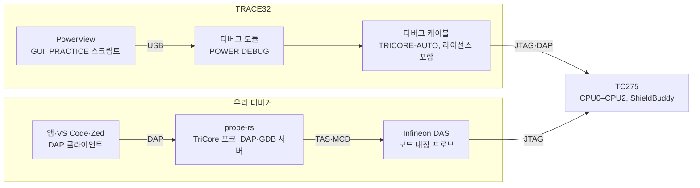

# TRACE32와 AURIX 디버거 비교 검토

2026-10-25. Claude Docs 원본: [TRACE32와 AURIX 디버거 비교 검토](https://claude.ai/artifact/BdHpNX6mRUyxvFomyM2TfX)

## 요약

우리 디버거는 TC275에서 TRACE32의 일상 디버깅 기능을 대부분 갖췄다. 실행 제어, 하드웨어·소프트웨어·데이터 BP, 세 코어 동시 정지, 소스·디스어셈블리, 변수·레지스터·주변장치, 실행 중 메모리 읽기, 플래시 쓰기가 보드에서 확인됐다. 크게 모자란 것은 트레이스(MCDS·AGBT)와 그 위의 분석, OS 인식, 스크립트 자동화, 안전 인증이다.

- **같거나 비슷함:** 실행 제어와 step 중 인터럽트 막기, 온칩 BP 8개(같은 하드웨어), 멀티코어 동시 정지, 리셋 뒤 BP 복원, PFLASH·DFLASH 쓰기, 실행 중 변수 읽기, 성능 카운터.
- **모자람:** 조건·횟수 BP의 실시간성(소프트웨어로 따져 적중마다 63–185 ms 멈춤, 2026-10-25 추가), 캐시 보기, 지원 칩(TC27x·TC36x뿐), 메모리 속도(TAS 경유 19.4 KiB/s), MCDS 기록(만들었으나 이 어댑터에서 검증하지 못함).
- **없음:** 온칩·오프칩 트레이스 분석, 코드 커버리지, AUTOSAR(ORTI) 인식과 프로파일링, GTM·HSM 보조 코어, PRACTICE 같은 스크립트 언어, 도구 인증(TQSK).
- **우리가 나음:** 라이선스와 전용 하드웨어가 필요 없고(보드의 Infineon DAS 프로브), DAP·GDB 표준이라 VS Code·Zed·자체 앱을 고를 수 있으며, 코어별 SEGGER RTT 입출력과 쓰기 보호가 기본이다.

결론: "보드에 붙여 코드를 고치는" 개발에는 지금도 쓸 만하다. "타이밍·성능·커버리지를 재고 증명하는" 작업에는 TRACE32를 대신할 수 없다.

## 비교 대상과 기준

TC275(ShieldBuddy, TC27x ED)를 디버깅하는 같은 일을 두 도구로 할 때를 비교했다.

| 구성 | TRACE32 | 우리 디버거 |
| --- | --- | --- |
| 화면 | PowerView(단일 GUI, AMP는 코어마다 GUI) | GPUI 독립 앱(B), 또는 VS Code·Zed 포크(A) |
| 디버그 엔진 | PowerView 안 | probe-rs 포크의 TriCore 지원 + DAP 서버(TCP), GDB 서버 |
| 프로브 | POWER 시리즈 디버그 모듈 + TriCore 디버그 케이블 | Infineon DAS: TAS 서버(TCP) 또는 MCD(`mcdxdas.dll`), 보드의 내장 프로브(AURDUINO) |
| 트레이스 | 온칩(ED의 EMEM), AGBT(PowerTrace Serial), DAP 스트리밍 | `probe-rs mcds record`로 `.mcds` 파일 저장, 해독은 Infineon 도구 |

트레이스 경로(TRACE32의 AGBT·온칩 트레이스)는 그리지 않았다.

기준은 세 가지다.

1. 기능이 있는가: TRACE32는 설명서(TriCore Debugger and Trace, Release 02.2026)와 제품 페이지, 우리 것은 커밋과 보드 시험 기록으로 판단했다.
2. TC275에서 돌아가는가: 우리 기능은 보드에서 확인한 것만 "있음"으로 센다. TRACE32는 이번에 실기로 재지 않았다.
3. 쓰기 편한가: 설정 방식, 비용, 다른 도구와의 연결.

TRACE32를 직접 돌려 본 수치(속도, 지연)는 없다. 속도 비교는 우리 측정값만 있다.

## 기능별 비교

일상 디버깅 기능(위 14개 행)은 대부분 같거나 비슷하고, 트레이스와 그 위의 분석·OS·인증(아래 행)에서 차이가 크다.

| 기능 | TRACE32 | 우리 디버거 | 판정 |
| --- | --- | --- | --- |
| 연결 | 리셋하며 연결(SYStem.Up), 실행 중 연결(Attach) | 실행 중 attach, `--connect-under-reset`, launch·restart(진입 함수까지 실행) | 비슷 |
| 실행 제어 | Go/Break, Step.Asm·Step.Hll, step 중 인터럽트 막기(IMASKASM·IMASKHLL) | continue·pause, step over·into·out, 명령 step, step 중 ICR.IE 끄기 | 같음 |
| 멀티코어 | SMP·AMP·iAMP, 동기 Go/Step/Break, 코어 전환 | 한 세션에 세 코어, 트리거 스위치로 하드웨어 동시 정지(allStop), 한 코어만 실행 | 비슷 |
| 보조 코어 | GTM·PCP 포함, HSM은 Cortex-M 라이선스 추가 | 없음 | 없음 |
| 온칩 BP | AURIX: 명령 BP 최대 8, 읽기·쓰기 최대 8개 주소 또는 4개 범위 | 트리거 유닛 8개를 명령 BP·데이터 BP(읽기·쓰기·범위)·성능 창이 나눠 씀 | 같음 |
| SW BP | RAM에 break 코드, 플래시는 가능하나 권장하지 않음 | 코어 자신의 PSPR에 debug 명령(32개), 강제 종료 뒤 원래 명령 복원 | 비슷 |
| 조건·횟수 BP | ED의 MCDS로 호출 횟수(/COUNT)와 데이터 값 조건 | 서버가 멈춘 뒤 따져 다시 실행: 조건(`v == 3 && k != 0`), 횟수(`3`, `>= 3`, `% 4`), 로그 지점, 데이터 BP 조건. 적중마다 63–185 ms 멈춤(probe-rs `c18738d`) | 모자람(실시간성) |
| 소스·디스어셈블리 | 소스·혼합·어셈블러 보기 | 소스 보기와 소스 BP, 코어별 디스어셈블리 창, 명령 BP | 비슷 |
| 변수·레지스터 | Var.View, 코어별 Register.view, 캐시 내용과 유효·dirty 비트 보기 | Static·Registers·지역 변수 트리, 바뀐 값 표시. 캐시 보기 없음 | 비슷 |
| 주변장치 | PER 파일 기반 레지스터 창(PER.view) | Infineon PD SVD 기반 Peripherals, 필드 쓰기 | 같음 |
| 실행 중 메모리 | 멈추지 않는 접근(SYStem.MemAccess Enable) 또는 잠깐 멈춰 접근 | Live Watch(세 코어, 0.5초), 메모리 탭 0.5초 갱신 | 같음 |
| 메모리 쓰기 | Data.Set, 플래시는 FLASH 명령 | RAM만(스크래치패드·LMU), 플래시·UCB·레지스터는 보내기 전에 거부 | 비슷 |
| 플래시 | 타깃 알고리즘, FLASH.ReProgram, HSM 플래시, UCB·BMHD 경고 | PF0·PF1·DF0, 같은 내용은 건너뜀, 지우기 전 섹터 백업, UCB는 맵에 없음 | 비슷 |
| 리셋 | 리셋을 지나 디버깅, BP·트레이스 설정 자동 복원, 워치독·STM 정지 | STM0로 리셋 감지, 트리거 유닛·SW BP 다시 쓰기, 계속 실행 또는 정지 | 비슷 |
| 터미널·RTT | TERM 창(타깃 메모리 버퍼 등 자체 방식). SEGGER RTT는 설명서에 없음 | SEGGER RTT 출력·입력, 코어별 채널 | 우리가 나음 |
| 트레이스 | 온칩(ED), MCDS로 최대 6코어의 프로그램·데이터·버스, 타임스탬프, AGBT 최대 8 GB, DAP 스트리밍, 트리거 언어 | MCDS 기록을 `.mcds`로 저장하는 명령만(이 어댑터가 맵 1을 막아 미검증), 해독은 Infineon 도구 | 없음 |
| 성능 분석 | BenchMarkCounter, AUTOSAR 프로파일링, 코드 커버리지(MC/DC까지) | 성능 카운터(CCNT·ICNT·M1–M3), 두 주소 사이 구간 | 모자람 |
| OS 인식 | ORTI로 태스크·ISR·runnable, 멀티 OS, TC4x 하이퍼바이저 | 없음 | 없음 |
| 자동화 | PRACTICE 스크립트(`.cmm`), 데모 스크립트, GUI 간 InterCom | DAP·GDB 서버, Rust 크레이트(aurix-dap-client), probe-rs 명령 | 모자람 |
| 다른 도구와 연결 | ETAS ETK·dSPACE·Vector VX1000과 포트 공유, XCP | 표준 DAP·GDB로 여러 IDE, TAS 서버를 여러 클라이언트가 함께 씀 | 비슷 |
| 지원 칩 | AURIX TC4x·TC3xx·TC2xx, AUDO | TC27x(TC275), TC36x | 모자람 |
| 안전·인증 | 도구 인증 키트(TQSK), TÜV Nord 추적 | 없음 | 없음 |

우리 열은 TC275에서 확인한 것만 적었다(TC36x는 커밋 메시지 기준). TRACE32 열은 설명서와 제품 페이지 기준이다.

## 연결과 하드웨어

TRACE32는 전용 디버그 모듈과 케이블(라이선스 포함)이 필요하고, 우리는 보드에 있는 Infineon DAS 프로브로 붙는다. 그 대신 우리 속도는 TAS 연결에 묶인다.

| 항목 | TRACE32 | 우리 디버거 |
| --- | --- | --- |
| 디버그 하드웨어 | POWER DEBUG INTERFACE(USB 3·USB 2)·POWER DEBUG PRO·POWER TRACE + TriCore 디버그 케이블(DEBUG-TRICORE-AUTO 등) | ShieldBuddy의 내장 DAS 프로브(`DAS JTAG AURDUINO`), Infineon TAS 서버 또는 MCD 라이브러리 |
| 인터페이스 | JTAG, DAP, DXCPL, DXCM | DAS가 열어 주는 연결(이 보드는 JTAG) |
| 트레이스 하드웨어 | 온칩은 ED 칩 + TriCore-MCDS 라이선스, AGBT는 POWER TRACE SERIAL, DAP 스트리밍은 CombiProbe 2 | 없음. MCDS를 읽으려면 맵 1을 여는 어댑터(예: DAP miniWiggler)가 따로 필요 |
| 라이선스 | 디버그 케이블에 디버그 라이선스, 멀티코어·트레이스·HSM은 별도 라이선스, 소프트웨어 라이선스는 RLM 또는 클라우드 서버 | probe-rs는 MIT·Apache-2.0, GPUI는 Apache-2.0. 우리 크레이트·앱은 미정 |

우리 속도(TC275, TAS, `perf_measure`와 DAP 측정):

| 작업 | 시간 |
| --- | --- |
| 레지스터 하나 읽기 | 1.0 ms |
| halt / run | 9.2 ms / 8.1 ms |
| 단일 step(하드웨어) | 30.9 ms |
| 메모리 읽기·쓰기 | 19.4 KiB/s(PFLASH 4 MB 전체 약 3.5분) |
| DAP step into / over / out | 176 / 114 / 122 ms |
| DAP continue → BP 정지 | 131 ms |
| DAP attach | 약 3.0 s |

TRACE32 수치는 이번에 재지 않았다. 우리 메모리 속도는 크기와 상관없이 어댑터 연결이 한계였다. MCD 경로나 다른 어댑터의 속도는 아직 재지 않았다.

## 우리 쪽이 나은 점

가장 큰 장점은 비용과 고칠 수 있다는 점이다. 기능 자체로 앞선 것은 RTT와 쓰기 보호 정도다.

- **추가 하드웨어·라이선스 없음:** 보드 내장 DAS 프로브로 바로 붙는다. 개발자마다 디버그 모듈과 케이블을 사지 않아도 된다.
- **표준 접속:** 같은 DAP 서버에 VS Code, Zed, 자체 GPUI 앱이 붙고, GDB 서버도 있다(GDB 11항목 통과). 쓰던 편집기를 그대로 쓸 수 있다.
- **직접 고침:** 소스가 우리 손에 있다. 시험 중 나온 Step Into 프롤로그 판정 문제(probe-rs 업스트림에도 있음), 엄격한 DAP 클라이언트가 드러낸 서버 문제 3건, 동시 정지 경쟁 조건을 모두 그날 고쳤다.
- **SEGGER RTT:** 코어별 출력 채널과 입력 채널을 따로 보여 주고 줄을 보낼 수 있다. TRACE32 설명서의 터미널 방식에는 RTT가 없다.
- **쓰기 보호가 기본:** 메모리 쓰기는 RAM만 허용한다. 플래시는 지우기 전에 섹터를 백업하고 같은 내용은 건너뛴다. UCB는 맵에서 빠져 있고, 두 ELF가 같은 섹터를 쓰면 거부한다. 디버거가 강제로 죽어도 다음 세션이 debug 명령과 트리거 설정을 되돌린다. TRACE32 설명서는 UCB·BMHD·HSM을 잘못 쓰면 칩이 영구히 잠길 수 있으니 조심하라고 사용자에게 맡긴다.
- **자동화에 맞는 모양:** 화면 없이 도는 Rust 클라이언트 예제(`rtt_tail`, `live_watch`)가 있어 CI에서 보드 시험을 돌리기 쉽다.

## 모자란 점과 그 크기

가장 큰 갭은 트레이스다. 분석 기능(커버리지, 프로파일링)은 트레이스 위에 서기 때문에, 트레이스가 없으면 따라올 수 없다. 나머지는 소프트웨어만으로 메울 수 있다.

| 갭 | 왜 필요한가 | 지금 막는 것 | 규모 |
| --- | --- | --- | --- |
| 트레이스(MCDS·AGBT) | 멈추지 않고 타이밍 문제, 간헐 버그, 코어 간 상호작용을 본다 | 이 어댑터가 주소 맵 1(EEC·MCDS)을 막는다(0x8D). Infineon의 기록 라이브러리도 읽지 못한다. AGBT는 전용 수신 하드웨어가 필요하다 | 큼 |
| 커버리지·프로파일링 | 안전 프로젝트의 커버리지 증빙, 함수·태스크 실행 시간 | 트레이스가 먼저다 | 큼 |
| OS 인식(ORTI) | AUTOSAR 태스크·ISR 상태를 한눈에 본다 | ORTI 파일을 읽지 않는다 | 중간 |
| 조건·횟수 BP | "1000번째 호출", "값이 0이 될 때" 멈추기 | 소프트웨어 조건은 됨(2026-10-25). 멈추지 않는 하드웨어 조건은 ED의 MCDS가 필요하다 | 작음(남은 것은 MCDS) |
| 스크립트 자동화 | 보드 설정·반복 시험을 한 번에 재현 | 스크립트 언어가 없다. Rust 코드나 DAP 요청을 직접 써야 한다 | 중간 |
| 칩·보조 코어 | TC3xx·TC4x 프로젝트, GTM·HSM 코드 | TC27x·TC36x만, TriCore 코어만 | 중간 |
| 속도 | 큰 이미지 플래시, 메모리 덤프 | TAS 경유 19.4 KiB/s | 중간 |
| 캐시 보기 | 캐시와 메모리가 다른 값을 가질 때 찾기 | 캐시 내용을 읽지 않는다 | 작음 |
| 도구 인증 | 안전 프로젝트에서 도구를 믿을 근거 | 인증 과정이 없다 | 큼 |

규모는 어댑터·인증처럼 우리가 다 할 수 없는 부분을 포함한 어림이다. 조건 BP는 호스트에서 조건을 평가하면 되지만, 멈췄다 다시 돌기 때문에 실시간성을 잃는다.

## 다음 단계 제안

트레이스 검증을 먼저 시작하고, 그동안 소프트웨어만으로 되는 작은 갭을 메우는 순서를 권한다. AGBT와 도구 인증은 범위 밖으로 두고, 그 일에는 TRACE32를 계속 쓴다.

1. **MCDS 기록 검증:** 주소 맵 1을 여는 어댑터(예: DAP miniWiggler)를 구해, 이미 만든 `probe-rs mcds record`를 TC275 ED에서 돌리고 Infineon 디코더로 열어 본다. 하드웨어 구매 결정이 필요하다.
2. ~~**조건·횟수 BP:** DAP의 `condition`·`hitCondition`을 호스트에서 평가한다. 멈췄다 다시 도는 방식이라 느리지만, 가장 자주 아쉬운 기능이다.~~ 2026-10-25 구현(probe-rs `c18738d`, 앱 B 편집 줄). 전역 변수만 쓰는 조건은 프레임을 풀지 않아 한 번에 63 ms다.
3. **ORTI 태스크 보기:** ORTI 파일을 읽어 태스크·ISR 상태를 변수 패널에 보인다. AUTOSAR 보드가 대상이다.
4. **스크립트 실행:** DAP 클라이언트 위에 명령 파일을 돌리는 도구를 둔다(attach, BP, continue, 값 확인). CI의 보드 시험에 바로 쓸 수 있다.
5. **속도 측정:** MCD 경로와 다른 어댑터로 같은 측정을 돌려, 19.4 KiB/s가 TAS의 한계인지 확인한다.
6. **칩 확대:** TC36x를 붙인 방식대로 프로젝트가 쓰는 TC3xx 칩을 더한다.

당분간은 일상 디버깅은 우리 디버거로, 트레이스·커버리지·인증이 필요한 일은 TRACE32로 나눠 쓰는 것이 현실적이다.

## 출처

- TRACE32: [TriCore Debugger & Trace 제품 페이지](https://www.lauterbach.com/bdmtc.html), [TriCore Debugger and Trace 설명서, Release 02.2026](https://www2.lauterbach.com/pdf/debugger_tricore.pdf)(온칩 BP 27쪽, 플래시 30–32쪽, 멀티코어 19–23쪽, SYStem.MemAccess 95쪽), [General Commands Reference Guide T](https://www2.lauterbach.com/pdf/general_ref_t.pdf)(TERM.METHOD 93–94쪽), [PER.view 지식 문서](https://support.lauterbach.com/kb/articles/can-i-open-automatically-a-specific-section-in-the-peripheral-file-with-trace32-command)
- 우리 디버거: [probe-rs TriCore · MCD · MCDS 연동 개발지시서(PRD)](https://claude.ai/artifact/GqYnnvgJjCWxkZUUsqJSzq)(구현 현황, 성능 측정, 알려진 제한), [Zed 디버거 검토와 A0 실기 시험](https://claude.ai/artifact/Gh846ob7JKdHV8Ux77HpDH)(Zed 포크와 GPUI 앱 B의 보드 시험), 이 저장소의 [`ZED_DEBUGGER_REVIEW.md`](ZED_DEBUGGER_REVIEW.md)
